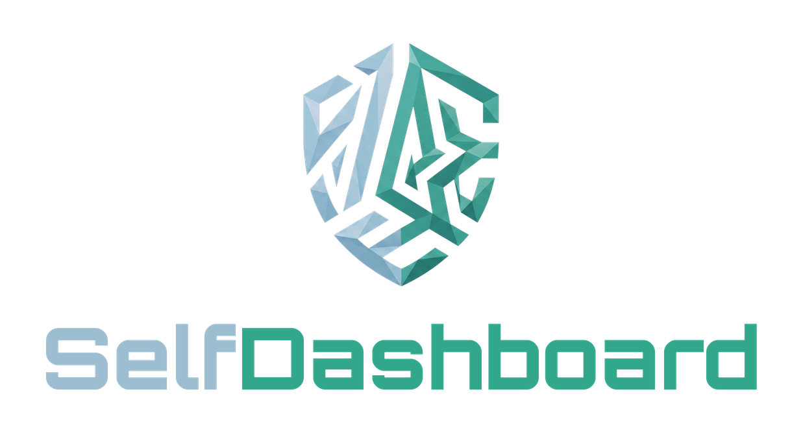
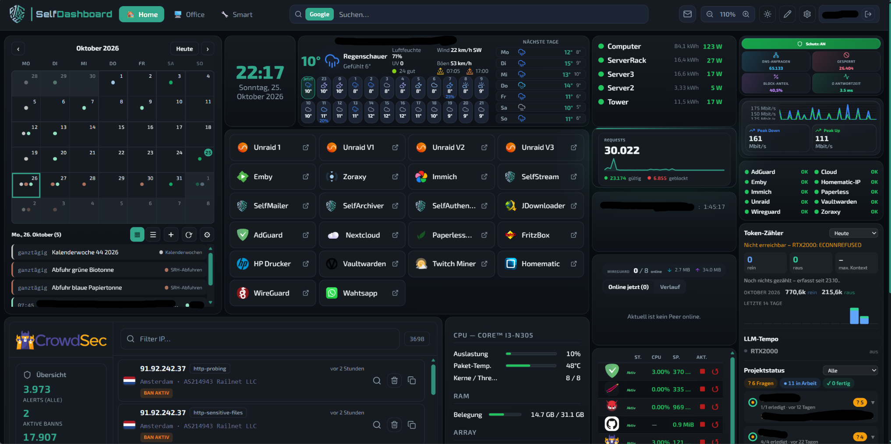

<div align="center">



**Self-hosted homelab dashboard — one container, one browser tab, live widgets from a plugin store.**<br>
*Selbstgehostetes Homelab-Dashboard — ein Container, ein Browser-Tab, Live-Widgets aus dem Plugin-Store.*

[](https://github.com/s3lfcod3r/selfdashboard/actions/workflows/docker-publish.yml)

[](LICENSE)


**[🇬🇧 English](#-english) · [🇩🇪 Deutsch](#-deutsch)**

📰 **What's new / Neuigkeiten** → [CHANGELOG.md](CHANGELOG.md)

</div>

---

<a id="-english"></a>

## 🇬🇧 English

SelfDashboard is your personal control center for homelab and self-hosting: **one Docker container**, **one browser tab** — instead of a dozen open admin UIs. Widgets are **plugins with real backends** (Docker, FRITZ!Box, CrowdSec, calendar, mail …), installed from a **Plugin Store** and configured entirely in the UI. It is **not** a plain bookmark page and **not** a YAML-config dashboard.

Part of the **Self** family (SelfMailer, SelfStream, SelfArchiver …) — same design system, same deploy style (GHCR → Unraid).

> **TL;DR** — live widgets via plugin store · multiple dashboards · login + 2FA + multi-user · kiosk mode for wall tablets · AES-256-GCM-encrypted credentials · single container · no external DB.

### 📑 Table of contents

[Features](#en-features) · [Plugins](#en-plugins) · [How it compares](#en-compare) · [Architecture](#en-architecture) · [Dashboards & widgets](#en-dashboards) · [Kiosk mode](#en-kiosk) · [Android app](#en-android) · [Login & multi-user](#en-login) · [Troubleshooting](#en-troubleshooting) · [Documentation](#en-docs) · [Quick start](#en-quick-start) · [Unraid](#en-unraid) · [Configuration](#en-configuration) · [Backups](#en-backups) · [Security](#en-security) · [Tech stack](#en-tech-stack) · [Development](#en-development) · [Roadmap](#en-roadmap)

<a id="en-features"></a>

### ✨ Features

Example layout below — SelfMailer calendar, clock, weather, FRITZ! history & power, AdGuard, bookmarks, Zoraxy, media, Uptime Kuma, WireGuard, CrowdSec, two Unraid servers, notes and the navbar mail badge. Every widget is a plugin, freely arrangeable and configurable.



**🧩 Plugins & updates**
- **Volume-only plugin system** — install from the **Plugin Store (GitHub)** or as **ZIP**; no widgets baked into the image
- **Plugin updates** — the store compares versions; badge + **Update all**, **no** image rebuild; **Ctrl+F5** after an update
- **Auto-index store** — drop a plugin folder into `plugins-pack/<id>/` and push; `plugins-index.json` regenerates automatically
- **Central error log** — **Settings → Logs**: app, API and plugin errors (filter, export, 3–30 day retention), automatic for every registered plugin

**📋 Dashboards & design**
- **Multiple dashboards**, each with its own URL (`/dashboard/home`, `/dashboard/server`)
- **6 color themes** (Dark, Light, Nord, Catppuccin, Dracula, Solarized) + **custom colors** per dashboard
- **Custom logo** per dashboard; **background images** — navbar wallpaper + dashboard (**1** or **2** JPG/PNG images) with readability overlay
- **Drag & drop**, free resizing, per-widget **zoom, padding and height**
- **Dashboard zoom** (60 %–150 %), adjustable **grid spacing** and outer padding
- **Navbar options** — icon only, text only or both; toggle dashboard tabs
- **Responsive layout** — **phone / tablet / desktop** grid based on dashboard width; optional per-widget overrides; compact **navbar search** (full-width row) on narrow viewports
- **Unit system** — global **metric (°C, km/h) / imperial (°F, mph) / auto** switch (Settings → General); Weather, FRITZ! Smart Home, Homematic and Google Home widgets pick up the choice (auto follows locale, defaults to metric)

**✉️ Navbar mail (IMAP)**
- Unread badge in the navbar — multiple accounts, Synology/MailPlus-friendly, encrypted passwords, click opens webmail

**🔐 Security & platform**
- **Login & multi-user** — SQLite auth, admin/user roles, plugin whitelist, optional **TOTP 2FA**
- **Secure by default** — non-root container, **AES-256-GCM**-encrypted credentials, SSRF guard on all proxy plugins
- **Kiosk mode** — public **`/kiosk`** URL, view-only full screen for wall tablets, optional password
- **Multilingual** — German & English interface
- **Single container** — Next.js 15, no external database (embedded SQLite for auth), no Redis
- **Unraid ready** — Community Apps template included

<a id="plugins"></a>
<a id="en-plugins"></a>

### 🧩 Plugins

Widgets are **not** bundled in the image — install them from the **Plugin Store** or upload a ZIP. Each plugin has its own **README (EN/DE)** under `plugins-pack/<id>/`. Install & folders: [docs/PLUGINS.md](docs/PLUGINS.md) · develop plugins: [docs/PLUGIN_DEV.md](docs/PLUGIN_DEV.md).

Plugins marked **(Beta)** are new integrations that have not yet been tested against every server version — feedback (with the service version) is welcome.

| Plugin | Category | Description |
|---|---|---|
| [AdGuard Home](plugins-pack/adguard/README.md) | Network | DNS stats, protection toggle (stat tiles fill the widget) |
| [Amazon Alexa](plugins-pack/alexa/README.md) | Media | Echo playback & volume, Alexa smart-home devices, routines (unofficial Alexa cloud API) **(Beta)** |
| [Apple Music](plugins-pack/apple-music/README.md) | Media | In-browser player **(Beta)** |
| [Bambu Lab Camera](plugins-pack/bambu-cam/README.md) | Utility | Live printer camera (P1/A1 local or stream URL) **(Beta)** |
| [Bookmarks](plugins-pack/bookmarks/README.md) | Utility | Quick links with groups (e.g. Unraid, Emby, Nextcloud, Immich, SelfMailer) |
| [Calendar](plugins-pack/calendar/README.md) | Productivity | CalDAV + ICS |
| [Clock](plugins-pack/clock/README.md) | Utility | Time, date, timezone |
| [CrowdSec](plugins-pack/crowdsec/README.md) | Security | Alerts, active bans, world map (optional) |
| [Docker](plugins-pack/docker/README.md) | System | Containers via socket |
| [Dreame](plugins-pack/dreame/README.md) | Utility | Robot vacuum status + start/pause/dock (cloud) **(Beta)** |
| [Email](plugins-pack/mail/README.md) | Productivity | Navbar IMAP badge, click opens webmail |
| [Emby](plugins-pack/emby/README.md) | Media | Active sessions |
| [FRITZ! WAN](plugins-pack/fritzbox/README.md) | Network | Internet throughput chart (down/up Mbit/s) with peaks (TR-064) |
| [FRITZ! Energy](plugins-pack/fritz-energy/README.md) | Network | Smart-plug power: now, today, 7 days, month (TR-064) |
| [FRITZ! Smart Home](plugins-pack/fritz-smarthome/README.md) | Utility | Thermostats, plugs, contacts (AHA) **(Beta)** |
| [Google Home / Nest](plugins-pack/google-home/README.md) | Utility | Nest thermostats, sensors, device status (SDM API) **(Beta)** |
| [Home Assistant](plugins-pack/home-assistant/README.md) | Utility | Selected entities **(Beta)** |
| [Homematic](plugins-pack/homematic/README.md) | Utility | Heating, switches, sensors, rooms (RaspberryMatic) **(Beta)** |
| [Iframe](plugins-pack/iframe/README.md) | Utility | Embed URLs |
| [Jellyfin](plugins-pack/jellyfin/README.md) | Media | Active sessions |
| [LLM-Cockpit](plugins-pack/llm-cockpit/README.md) | System | Token counter (today/month, daily history), LLM speed and project status in one tile — needs the small collector service (`/tokens`, `/status`) |
| [LLM-Tempo](plugins-pack/llm-tempo/README.md) | System | Tokens per second of local llama.cpp servers (needs `llama-server --metrics`) |
| [NetzWacht](plugins-pack/netzwacht/README.md) | Security | Live throughput, top devices and Suricata alerts from an ntopng stack **(Beta)** |
| [Nginx Proxy Manager](plugins-pack/npm/README.md) | Network | Proxy hosts overview **(Beta)** |
| [OpenMediaVault](plugins-pack/openmediavault/README.md) | Storage | System info via RPC **(Beta)** |
| [OPNsense](plugins-pack/opnsense/README.md) | Network | Version, gateways **(Beta)** |
| [Parcel Tracking](plugins-pack/parcel/README.md) | Utility | DHL / Hermes / DPD tracking, no API key |
| [Philips Hue](plugins-pack/hue/README.md) | Utility | Lights & rooms control **(Beta)** |
| [Pi-hole](plugins-pack/pihole/README.md) | Network | Pi-hole v6 stats |
| [Plex](plugins-pack/plex/README.md) | Media | Active sessions **(Beta)** |
| [Project status](plugins-pack/openclaw-status/README.md) | Utility | Where each project stands and which questions wait for you, read from `STATUS.md` files of an AI agent |
| [Proxmox VE](plugins-pack/proxmox/README.md) | System | Nodes, VMs/LXC **(Beta)** |
| [Reolink Camera](plugins-pack/reolink/README.md) | Utility | Live camera, AI/motion badges, PTZ **(Beta)** |
| [Scratchpad](plugins-pack/scratchpad/README.md) | Utility | Short notes pinned to the dashboard |
| [SelfMailer](plugins-pack/selfmailer/README.md) | Productivity | Unread mail across all SelfMailer mailboxes (total, per account, newest) |
| [SelfMailer Calendar](plugins-pack/selfmailer-calendar/README.md) | Productivity | Month view of upcoming SelfMailer events; create events directly in SelfMailer |
| [Selfstream](plugins-pack/selfstream/README.md) | Media | Live IPTV |
| [Selfstream · Emby · Jellyfin](plugins-pack/selfstream-emby/README.md) | Media | Combined stream list with a configurable title |
| [Shelly 3EM](plugins-pack/shelly-3em/README.md) | System | 3-phase power, import/export, kWh history |
| [Shelly Plug](plugins-pack/shelly-plug/README.md) | System | Several plugs per tile, power + on/off switch, kWh today / this month |
| [Speedtest Tracker](plugins-pack/speedtest-tracker/README.md) | Network | Latest down/up/ping **(Beta)** |
| [Spotify](plugins-pack/spotify/README.md) | Media | Now playing, controls, seek, volume, search & device picker |
| [Token counter](plugins-pack/llm-token/README.md) | System | Tokens used by your AI agent (in, out, largest context), monthly statistics |
| [TrueNAS](plugins-pack/truenas/README.md) | Storage | System + pool status **(Beta)** |
| [UniFi Controller](plugins-pack/unifi/README.md) | Network | WLAN/LAN/WAN status **(Beta)** |
| [Unraid](plugins-pack/unraid/README.md) | System | CPU, RAM, array/pool and disks per server (Unraid **7.2+** GraphQL) |
| [Unraid Docker](plugins-pack/unraid-docker/README.md) | System | Containers via Unraid API |
| [Uptime Kuma](plugins-pack/uptime-kuma/README.md) | Network | Status-page monitors (up / down / pending) in a compact list |
| [Waste Collection](plugins-pack/muell/README.md) | Utility | Bin pickup calendar, next-up countdown, local |
| [Weather](plugins-pack/weather/README.md) | Utility | Open-Meteo (proxy), day blocks (0–6 … 18–24) + 7-day forecast from tomorrow |
| [WireGuard](plugins-pack/wireguard/README.md) | Network | wg-easy peers — online now / total, handshake history, live up/down traffic **(Beta)** |
| [Zoraxy](plugins-pack/zoraxy/README.md) | Network | Reverse-proxy hosts, valid vs. blocked requests **(Beta)** |

All plugin READMEs are bilingual (EN/DE). Brand logos in the store via [homarr-labs/dashboard-icons](https://github.com/homarr-labs/dashboard-icons).

<a id="en-compare"></a>

### ⚖️ How it compares

Heimdall, Homarr, Dashy and Homepage are all great projects — SelfDashboard just focuses on something different: **live widgets with real backends, built-in auth and a kiosk mode**, all configured in the UI.

| | SelfDashboard | Heimdall | Homarr | Homepage |
|---|---|---|---|---|
| Widgets with real backend | yes, plugin system | limited | some | via API/YAML |
| Configuration | UI, no YAML | UI | UI | YAML files |
| Login + 2FA + multi-user | built in | no | partial | no |
| Kiosk mode | yes | no | no | no |
| Encrypted credentials | AES-256-GCM | – | – | – |

**A good fit if you want**
- Live, interactive widgets (Docker control, FRITZ!Box, CrowdSec, calendar, mail) — not just links
- Multi-user with real auth / 2FA and a wall-tablet kiosk
- To configure everything in the UI instead of editing config files

**Maybe not for you if**
- You just want a simple bookmark/start page (Heimdall or Homepage are lighter for that)
- You can't run a Docker container, or prefer a purely static config-file workflow
- You need a large, established plugin ecosystem today — SelfDashboard's is younger and still growing

> **⚠️ Note:** plugin server code runs with the app's privileges (no sandbox yet) — only install plugins you trust.

<a id="en-architecture"></a>

### 🧭 Architecture

```text
 GitHub, branch main (catalog)            Host volume /app/plugins/custom
 plugins-pack/plugins-index.json          per plugin: plugin.json
 plugins-pack/<id>/widget.js                          + widget.js
                   (+ server.mjs)                     (+ server.mjs for some)
          │                                      ▲            │
          └──── Store: Install / Update ─────────┘            │ browser loads widget.js
                                                              ▼
 ┌─────────────────────── Docker image (core) ─────────────────────────┐
 │  Next.js UI · Plugin Store · dashboards                              │
 │  Built-in APIs: calendar, mail, docker, crowdsec, fritzbox, weather …│
 │  Gateway /api/plugins/{id}/…  ← plugin server.mjs                    │
 └──────────────────────────────────┬───────────────────────────────────┘
                                    │
                     Host volume /app/data
           dashboards · auth DB · calendar · central log
```

| Layer | Location | Purpose |
|---|---|---|
| **Core app** | Docker image `ghcr.io/s3lfcod3r/selfdashboard` (`:latest`) | Dashboard UI, settings, logging, plugin store, most `/api/*` routes |
| **Installed plugins** | Host → `/app/plugins/custom/<id>/` | Widgets the browser runs (`widget.js`); survives image updates |
| **Plugin catalog** | GitHub `plugins-pack/` on branch `main` (configurable) | `plugins-index.json` + files the store downloads on install/update |
| **Plugin source (dev)** | `plugins-pack/<id>/` (`index.tsx`, `widget.js`, optional `server.ts`) | Store ships UI + bundled `server.mjs`; image builtins remain fallback |
| **App data** | Host → `/app/data` | `dashboard.json`, calendar DB, central log |

#### App update vs. plugin update

| You change… | New Docker image? | What to do |
|---|---|---|
| A **plugin** (`widget.js` and/or `server.mjs` on GitHub) | **No** | Plugin Store → **Update** (or **Update all**) → **Ctrl+F5** |
| **SelfDashboard core** (UI, APIs, store, loader) | **Yes** | `docker pull` + restart container; keep `/app/data` and `/app/plugins/custom` mounts |

<a id="en-dashboards"></a>

### 🖥️ Dashboards & widgets

#### Managing dashboards

Each dashboard gets its own URL. Navigate between dashboards via the tab bar in the navbar or through **Settings → Dashboards**.

| Action | How |
|---|---|
| Create dashboard | Settings → Dashboards → New Dashboard |
| Switch dashboard | Click tab in navbar or Settings → Dashboards → Open |
| Hide tab from navbar | Settings → Dashboards → 👁️ toggle per dashboard |
| Delete dashboard | Settings → Dashboards → 🗑️ |
| Rename / change icon | Settings → Dashboards → ✏️ |

#### Widget controls

In **Edit Mode** (✏️ button), hover over any widget to see controls:

| Control | Function |
|---|---|
| ⠿ Drag handle | Move widget |
| 🔍 `− 100% +` | Zoom widget content |
| ↔ `− 8 +` | Inner padding |
| ↕ `− 4 +` | Widget height |
| ⚙️ | Plugin settings |
| ✕ | Remove widget |
| Resize grip (corner/edge) | Resize width and height freely |

#### Responsive layout (phone, tablet & desktop)

The dashboard uses **three layout bands** based on the **dashboard grid width** (the track that holds the widgets — not only the outer browser window):

| Band | Approx. width | Behaviour |
|---|---|---|
| **Phone** | **< 768 px** | Single **stacked column**; each widget uses **`layoutPhone`** height overrides when set, otherwise the desktop **`layout`** height. |
| **Tablet** | **768 – 1023 px** | **12-column** grid like desktop; optional **`layoutTablet`** overrides (`w`, `h`, `x`, `y`, `minH`) merge with **`layout`**. |
| **Desktop** | **≥ 1024 px** | Full **desktop** layout — what you usually edit when resizing widgets on a large screen. |

**How to tune it:** enter **Edit mode** (✏️), open a widget's **⚙️** settings. Below the plugin-specific options, **"Layout: phone & tablet"** lets you set optional **phone** row height / min height and **tablet** position & size. **Leave fields empty** to keep using the desktop layout values for that band.

On **narrow viewports (about ≤ 1024 px)** the **navbar web search** moves to a **second row** at **full width** so it is not squeezed into the corner next to zoom and actions.

Plugins can optionally read the **`layoutMode`** prop (`'phone' | 'tablet' | 'desktop'`) for their own responsive UI — see [docs/PLUGIN_DEV.md](docs/PLUGIN_DEV.md).

#### Settings overview

- **General** — language (DE/EN), dashboard title, navbar web search, navbar mail badge, navbar display style, dashboard tab visibility, **unit system** (metric/imperial/auto)
- **Users** — change password, **2FA (TOTP)**, **kiosk / wall tablet** (admin). Admins also manage users and the plugin whitelist here.
- **Dashboards** — create, edit, delete dashboards; toggle tab visibility per dashboard; set emoji or custom PNG icon
- **Design** — navbar display style; grid spacing; **navbar background** (JPG/PNG + overlay); **dashboard background** (off / 1 image / 2 images side by side + overlay); logo upload; color theme; custom color overrides
- **Email** — IMAP accounts, navbar badge, poll interval, connection test
- **Logs** — central error log for support and debugging: filter by level, source, plugin; download `.txt` / JSONL; retention 3 / 7 / 30 days. Every plugin registered via `registerPlugin` logs render failures and failed `/api/*` calls automatically. Mail uses the same log with plugin id **`mail`**. Details: [docs/LOGGING.md](docs/LOGGING.md).

<a id="en-kiosk"></a>

### 📺 Kiosk mode (wall tablet)

Public **view-only** display for a wall-mounted tablet or guest browser — separate from the normal logged-in dashboard. Ideal for a kitchen display, wall tablet or shared screen on your LAN.

| Topic | Details |
|---|---|
| **Display URL** | **`http://YOUR-IP:3000/kiosk`** — no admin login, full-screen widgets, no navbar |
| **Configure (admin)** | **Settings → Users → Kiosk / wall tablet** — enable, pick dashboard, optional password, session duration (2 h … unlimited) |
| **Edit widgets** | Log in as admin → **`/dashboard/<id>`** (e.g. `/dashboard/kiosk`) → edit mode — same as any dashboard |
| **Do not confuse** | **`/kiosk`** = display only · **`/dashboard/kiosk`** = edit with login |
| **Plugins** | Only widgets on the chosen kiosk dashboard are loaded (works in any browser, no SelfDashboard account needed when passwordless) |
| **HTTP / LAN** | Cookies work on HTTP by default; set `SELFDASHBOARD_SECURE_COOKIES=1` only behind HTTPS |

<a id="en-android"></a>

### 📱 Android app

The **SelfDashboard Android app** shows the dashboard full screen on wall tablets. It contains **no backend code of its own** — it only displays your SelfDashboard web app.

| Topic | Details |
|---|---|
| **Modes** | **Login mode** (normal dashboard with login) or **kiosk mode** (view-only, no login) |
| **Download (APK)** | [github.com/s3lfcod3r/selfdashboard/releases/latest](https://github.com/s3lfcod3r/selfdashboard/releases/latest) — currently **v1.0.4** (app version, separate from the dashboard version 2.2.0) |
| **Features** | WebView, pull-to-refresh, full screen, screen saver |

<a id="en-login"></a>

### 🔐 Login & multi-user

SelfDashboard requires login. On first start (no users yet) you are redirected to **`/setup`** to create the admin account. Existing `dashboard.json` in appdata is migrated to that admin automatically (backup: `dashboard.json.pre-auth-migrated`).

| Topic | Details |
|---|---|
| **Roles** | **admin** — full access, plugin store, user management · **user** — only whitelisted plugins |
| **User data** | `/app/data/users/<id>/dashboard.json` per user |
| **Auth data** | `/app/data/auth/auth.db` (users, sessions, plugin whitelist) |
| **Admin UI** | **Settings → Users** — create/delete users, reset passwords, plugin checkmarks, **kiosk config** |
| **Self-service** | **Settings → Users** — change password, enable **2FA (TOTP)** |
| **2FA** | Optional authenticator at login — setup under **Settings → Users** |
| **Forgot password (no email)** | Env reset: `SELFDASHBOARD_AUTH_RESET_PASSWORD` → restart (see below) |
| **Backup** | Back up all of **`/app/data`** (at least `auth/` + `users/`) |
| **Dev only** | `SELFDASHBOARD_AUTH_DISABLED=1` disables auth (never in production) |

<details>
<summary><b>Setup — admin locked out (forgot password)</b></summary>

There is **no email reset** (would need SMTP — not typical for homelab). Simplest is the env reset on Unraid:

1. **Env password reset (recommended on Unraid)** — edit container, add variable:
   - `SELFDASHBOARD_AUTH_RESET_PASSWORD` = your new password (min. 8 chars)
   - optional: `SELFDASHBOARD_AUTH_RESET_USER=admin` (default: first admin)
   - or one field: `SELFDASHBOARD_AUTH_RESET=admin:NewPassword`
   - in production also `SELFDASHBOARD_ENABLE_ENV_RESET=1` (see [Configuration](#en-configuration))
   - **Restart container** → sign in → **clear the variable(s)** → restart again
2. **Direct CLI** (shell access):

   ```bash
   docker exec selfdashboard node /app/scripts/auth-reset-password.mjs --username admin --password 'NewSecurePass'
   ```

3. **Second admin** — reset password under **Settings → Users**.
</details>

<a id="en-troubleshooting"></a>

### 🩺 Troubleshooting

<details>
<summary><b>Problems & solutions</b></summary>

| Problem | Solution |
|---|---|
| Dashboard not loading | Check logs: `docker logs selfdashboard` |
| **Dashboard / widgets load slowly** | Measure first: browser console (F12) ~10 s after loading → `copy(__sdPerfReport.text)` shows render time per widget and what blocks the browser; server side `docker logs selfdashboard 2>&1 \| grep timing` shows slow plugin requests (`handler` = the service behind the plugin) and offline hosts (`[upstream]`). Widgets of devices that are permanently off cost ~3 s once after each restart — remove them. See [docs/PLUGIN_PERFORMANCE.md](docs/PLUGIN_PERFORMANCE.md) |
| **Plugin / mail fails with `blocked_url` / `private_ip_blocked`** | The target service runs on a **private LAN IP** (e.g. `192.168.x`), which is blocked by default since **2026-07**. Add **`SELFDASHBOARD_ALLOW_PRIVATE_URLS=1`** to the container and recreate it. Affects AdGuard, Pi-hole, FRITZ!, SelfMailer and any other LAN-hosted backend. |
| **500 error after update** (`SQLITE_READONLY` in logs) | The container runs **non-root** (PUID/PGID). The entrypoint fixes volume ownership automatically on start; if you set `SELFDASHBOARD_SKIP_CHOWN=1`, run `chown -R <PUID>:<PGID>` on your appdata folder yourself. |
| **CrowdSec: `unable to open database file`** (often after nightly backups) | Set the container's **PUID/PGID to the same values as your CrowdSec container** (Unraid default 99/100). Then SelfDashboard reads `crowdsec.db` as the owner — permanently, no chmod. |
| **Plugin shows `401` / `stats_failed` / auth error** (AdGuard, Pi-hole, FRITZ!, …) although credentials are correct | The encryption key changed. **Fix once:** set a fixed **`SELFDASHBOARD_SECRET_KEY`** (long random string) in Docker, restart, then re-enter the plugin's password in its settings and **Save**. The key never changes again → stays working. (On an older core image, also set `SELFDASHBOARD_CALENDAR_KEY` to the **same** value until you pull the new `:latest`.) |
| Config lost after update | Image updates do not remove your appdata volume; your layout lives in **`/app/data/users/<userId>/dashboard.json`** (plus a `localStorage` cache). If a **new browser** shows an empty dashboard, check **`/app/data`** is mounted and writable (see [Unraid](#en-unraid)). |
| Plugin store empty / "GitHub not configured" | Set `SELFDASHBOARD_PLUGINS_GITHUB_*` or use the official `:latest` image defaults |
| Widget stuck on "Loading plugin…" | Wait a few seconds; **Plugin Store → Reload plugins**; check files under `/app/plugins/custom/<id>/widget.js` |
| Update installed, UI unchanged | **Ctrl+F5** (hard reload) — browser caches `widget.js` |
| Plugin not found after install | Confirm **Plugins Storage** mount; folder must contain `plugin.json` + `widget.js` (not `index.tsx`) |
| Port already in use | Change host port: `-p 3001:3000` |
| Widgets invisible in edit mode | Try refreshing the page |
| Theme not applying | Hard refresh: Ctrl+Shift+R |
| CrowdSec widget: `crowdsec.db not found` | Set **CrowdSec Data (optional)** in the Unraid template (host folder with `crowdsec.db` → `/crowdsec-data:ro`), or remove the widget if you do not use CrowdSec |
| CrowdSec: no country flags / all `??` | Ensure **GeoLite2-City.mmdb** (or Country) is in the mounted CrowdSec data folder, or set `CROWDSEC_GEOIP_PATH` |
| CrowdSec: unban fails | Set `CROWDSEC_LAPI_URL`, `CROWDSEC_LAPI_MACHINE_ID`, `CROWDSEC_LAPI_PASSWORD` (machine from `cscli machines add … -f /dev/null`), enable unban in the plugin settings — no Docker socket needed |
| Mail badge red/yellow, count 0 | **Settings → Email** → re-enter password → **Save**. Set fixed `SELFDASHBOARD_SECRET_KEY` in Docker. Check **Logs** filter `mail` |
| Mail: `ENOTFOUND host:5000` | IMAP host must be IP/hostname only (e.g. `192.168.1.15`), port **993** separate; webmail URL goes in **Webmail URL** field |
| Mail test OK, navbar empty | Enable **Navbar email** (General or Email tab); save account; badge needs unread > 0 |
| Mail badge shows mail that is gone in MailPlus | IMAP may still list deleted/read messages until the server cleans up. Use **Show unread** in email settings to see subjects. After update, SelfDashboard ignores `\Deleted` and `\Seen` ghosts. In MailPlus: empty trash / expunge if needed, then **Refresh all accounts**. |
| MailPlus shows 1 unread, preview listed 2 (old FRITZ mail) | Synology IMAP can keep ancient `UNSEEN` UIDs. Use **Settings → Email → Unread age filter** (default 30 days; `0` = off). Preview shows how many were ignored as too old or duplicate `Message-ID`. |
| Weather: **HTTP 404** on plugin API | **New app image** required — route is in the core app (`/api/plugins/weather/…`), not a volume-only plugin |
| Weather: no data / API error | Container must reach `api.open-meteo.com` and `geocoding-api.open-meteo.com` (HTTPS outbound). Test: `http://HOST:PORT/api/plugins/weather/resolve?name=Berlin&language=de` → JSON |
| Weather plugin old UI (hourly strip only) | Plugin Store → **Weather** → **Update** → **Ctrl+F5** (target **1.3.x**) |
| Unraid: **`Failed to fetch`** | Browser calls Unraid **directly** (`https://NAS/graphql`). Not a 7.3-only issue — check **API key**, URL, HTTPS cert, and **CORS / allowed origins** for your dashboard URL (e.g. `http://192.168.x.x:3010`) on **each** NAS |
| Unraid works on one NAS, not another | Compare API enabled, key permissions, and CORS on the failing box (**7.2.3** and **7.3** both supported if GraphQL API is active) |
| Background image not visible | **Design** → mode not **Off**; image uploaded; after change **Ctrl+F5**; very large images are capped (~4–5 MB in config) |
| Kiosk shows login instead of widgets | Use **`/kiosk`**, not **`/dashboard/…`**. Enable kiosk under **Settings → Users → Kiosk** |
| Kiosk: "Plugin not found" | Open **`/kiosk`** once as admin (updates plugin list), then retry guest browser; **Ctrl+F5** |
| Home dashboard broken after visiting `/kiosk` | Update to latest image (kiosk cookie no longer overrides admin session); **Ctrl+F5** |
</details>

<a id="en-docs"></a>

### 📚 Documentation

| Topic | Document |
|---|---|
| Install & update plugins | [docs/PLUGINS.md](docs/PLUGINS.md) |
| Write & publish plugins | [docs/PLUGIN_DEV.md](docs/PLUGIN_DEV.md) |
| Plugin architecture | [docs/PLUGIN_ARCHITECTURE.md](docs/PLUGIN_ARCHITECTURE.md) |
| Plugin distribution model | [docs/PLUGIN_DISTRIBUTION.md](docs/PLUGIN_DISTRIBUTION.md) |
| Plugins as volume + ZIP | [docs/CUSTOM_PLUGINS_VOLUME.md](docs/CUSTOM_PLUGINS_VOLUME.md) |
| Plugin performance (dev) | [docs/PLUGIN_PERFORMANCE.md](docs/PLUGIN_PERFORMANCE.md) |
| Builtin servers in git / CI | [docs/PLUGINS_IN_REPO.md](docs/PLUGINS_IN_REPO.md) |
| Docker image build | [docs/DOCKER_BUILD.md](docs/DOCKER_BUILD.md) |
| Per-plugin setup (EN/DE) | [docs/plugins/README.md](docs/plugins/README.md) |
| Recent API/plugin changes | [docs/CHANGELOG.md](docs/CHANGELOG.md) |
| Error log | [docs/LOGGING.md](docs/LOGGING.md) |
| Unraid template details (`NODE_TLS_REJECT_UNAUTHORIZED`) | [unraid/README.md](unraid/README.md) |

<a id="en-quick-start"></a>

### 🚀 Quick start (Docker)

```bash
docker run -d \
  --name selfdashboard \
  --restart unless-stopped \
  -p 3000:3000 \
  -e TZ=Europe/Berlin \
  -v /mnt/user/appdata/selfdashboard:/app/data \
  -v /mnt/user/appdata/selfdashboard/plugins:/app/plugins/custom \
  -v /var/run/docker.sock:/var/run/docker.sock \
  ghcr.io/s3lfcod3r/selfdashboard:latest
```

Or with docker compose (see [docker-compose.yml](docker-compose.yml)):

```bash
git clone https://github.com/s3lfcod3r/selfdashboard.git
cd selfdashboard
docker compose up -d
```

Open `http://<host>:3000` → **`/setup`** creates the admin account → **Plugin Store → From GitHub**, install the widgets you need → **+** to place them → **Ctrl+F5** if a widget stays blank.

- **Required:** map **`/app/data`** (`dashboard.json`, calendar, logs) and **`/app/plugins/custom`** (installed plugins). Without the plugins folder, the store can install files but they will not persist.
- **Optional:** Docker socket — **Docker** plugin only; CrowdSec mount — **CrowdSec** plugin only.
- **Image tags:** the Unraid template uses **`ghcr.io/s3lfcod3r/selfdashboard:latest`**. The plugin catalog is loaded from GitHub branch **`main`** (`SELFDASHBOARD_PLUGINS_GITHUB_REF`, normally left as-is).
- **LAN services:** if your widgets talk to LAN addresses (AdGuard, Pi-hole, FRITZ!, Home Assistant …), set `SELFDASHBOARD_ALLOW_PRIVATE_URLS=1`.

<a id="en-unraid"></a>

### 📦 Unraid

Add the template from
`https://raw.githubusercontent.com/s3lfcod3r/selfdashboard/main/unraid/selfdashboard.xml`
or import it under *Docker → Add Container → Template*.

<details>
<summary><b>Setup — Unraid Community Apps (recommended)</b></summary>

1. Open Community Apps → search for **SelfDashboard**
2. Install — set **Config Storage**, **Plugins Storage**, port (default `3000`)
3. Open `http://YOUR-IP:3000`
4. **Plugin Store → From GitHub** — install widgets you need (Calendar, Bookmarks, …)
5. Click **+** to place widgets on the dashboard → **Ctrl+F5** if a widget stays blank
</details>

| Mount / setting | Content |
|---|---|
| **`/app/data`** (Config Storage) | Per-user dashboards (`users/`), auth DB (`auth/`), calendar, central log — **back up** regularly |
| **`/app/plugins/custom`** (Plugins Storage) | Installed plugins (`<id>/plugin.json`, `widget.js`, optional `server.mjs`) — **back up** with appdata |
| **GitHub env vars** | Pre-set in `:latest` image: repo `s3lfcod3r/selfdashboard`, ref `main`, path `plugins-pack` |
| **Docker Socket** (optional) | Local host only — [Docker plugin](docs/plugins/docker/README.md) |
| **CrowdSec Data** (optional) | `crowdsec.db` read-only — [CrowdSec plugin](docs/plugins/crowdsec/README.md) |

Both **Config Storage** and **Plugins Storage** are required for a normal setup. After a **plugin** update: Store → **Update** → **Ctrl+F5**. After an **app** update: pull new image, restart — layouts and installed plugins stay on the volumes.

> **⚠️ Secret key:** set a fixed `SELFDASHBOARD_SECRET_KEY` and never change it afterwards — it encrypts all stored credentials. Changing it makes them unreadable.
>
> **⚠️ Permissions:** the container runs **non-root**. The template sets PUID/PGID **99/100** (`nobody:users`); on start the entrypoint remaps to your PUID/PGID and chowns `/app/data` + `/app/plugins/custom` automatically (opt-out: `SELFDASHBOARD_SKIP_CHOWN=1`). **CrowdSec tip:** set PUID/PGID to the **same values as your CrowdSec container** — then SelfDashboard owns and reads `crowdsec.db` directly, surviving nightly backups that restart CrowdSec (no chmod needed).
>
> **⚠️ LAN access:** the template pre-sets `SELFDASHBOARD_ALLOW_PRIVATE_URLS=1` (recommended in a home network), so widgets can reach LAN services.
>
> **⚠️ Self-signed HTTPS:** leave `NODE_TLS_REJECT_UNAUTHORIZED` empty; `0` disables certificate checks for **all** outgoing HTTPS. Details: [unraid/README.md](unraid/README.md).

<a id="en-configuration"></a>

### ⚙️ Configuration

Environment variables, mostly with the prefix `SELFDASHBOARD_`, plus a few runtime and plugin variables.

| Variable | Required | Default | Purpose |
|---|---|---|---|
| `TZ` | – | `Europe/Berlin` | Timezone |
| `NODE_ENV` | – | `production` | Node.js environment |
| `PUID` / `PGID` | – | `1001` (image), `99` / `100` (Unraid template) | User/group the app runs as; entrypoint remaps and chowns the volumes |
| `SELFDASHBOARD_SKIP_CHOWN` | – | `0` | `1` = never touch volume ownership on start |
| `SELFDASHBOARD_FIX_CROWDSEC_PERMS` | – | `1` | `0` = don't add read permissions on `/crowdsec-data` |
| `SELFDASHBOARD_DATA_DIR` | – | `/app/data` (in the official image) | Directory inside the container where **`dashboard.json`** is stored. Must match your **`/app/data`** bind-mount unless you intentionally use another path. |
| `SELFDASHBOARD_SECRET_KEY` | – | auto-generated file in data dir | **Central secret key** for encrypting **all** stored credentials: calendar, mail **and widget passwords/tokens** (AdGuard, Pi-hole, FRITZ!, Speedtest, …). **Strongly recommended:** set a fixed value so credentials survive image updates and volume moves. Once set, never change it. (Legacy alias `SELFDASHBOARD_CALENDAR_KEY` still works as a fallback.) |
| `SELFDASHBOARD_ALLOW_PRIVATE_URLS` | – | off (private IPs **blocked**); `1` in the Unraid template | `1` lets plugins reach **private/LAN IPs** (`10/8`, `172.16/12`, `192.168/16`). Since **2026-07** private targets are blocked by default (SSRF protection). **Home-lab setups that point AdGuard, Pi-hole, FRITZ!, SelfMailer, Home Assistant … at LAN addresses must set this to `1`** — otherwise those widgets fail with `private_ip_blocked` / `blocked_url`. (Legacy `SELFDASHBOARD_BLOCK_PRIVATE_CALENDAR_URLS` is no longer needed.) |
| `SELFDASHBOARD_SECURE_COOKIES` | – | off | `1` marks session/kiosk cookies **Secure** (HTTPS only). Default off so HTTP on LAN works. **Set to `1` when exposing the app over HTTPS.** |
| `SELFDASHBOARD_INSECURE_COOKIES` | – | – | `1` forces non-Secure cookies (same as default on HTTP) |
| `SELFDASHBOARD_TRUST_PROXY` | – | off | `1` **only** when a reverse proxy in front sets `X-Forwarded-For`/`X-Real-IP`. When off, those (client-spoofable) headers are ignored for rate limiting. Account brute-force protection works regardless (persistent per-account lockout). |
| `SELFDASHBOARD_AUTH_RESET_PASSWORD` | – | – | One-shot admin password reset on container start (see [Login & multi-user](#en-login)) |
| `SELFDASHBOARD_AUTH_RESET_USER` | – | first admin | User for the env password reset |
| `SELFDASHBOARD_AUTH_RESET` | – | – | Combined form `user:password` for the env password reset |
| `SELFDASHBOARD_ENABLE_ENV_RESET` | – | off | In **production** (`NODE_ENV=production`, the default in the official image) the env password reset is **ignored** unless this is `1`. Safety net so a forgotten `NODE_ENV` cannot leave the reset path silently active. |
| `SELFDASHBOARD_AUTH_DISABLED` | – | – | `1` disables auth — **dev only, never in production** |
| `SELFDASHBOARD_PLUGINS_CUSTOM` | – | `<app>/plugins/custom` | Installed plugins (Unraid: map host folder here) |
| `SELFDASHBOARD_PLUGINS_GITHUB_REPO` | – | `s3lfcod3r/selfdashboard` in `:latest` image | GitHub repo for the store (`owner/repo`) |
| `SELFDASHBOARD_PLUGINS_GITHUB_REF` | – | `main` | Branch/tag for `plugins-pack/` |
| `SELFDASHBOARD_PLUGINS_GITHUB_PATH` | – | `plugins-pack` | Path in repo to plugin files |
| `MAIL_DATA_DIR` | – | `<plugins/custom>/mail` | Directory for **`mail.json`** (optional override) |
| `CALENDAR_SYNC_INTERVAL_SECONDS` | – | `300` | Calendar background sync interval |
| `CROWDSEC_DATA_DIR` | – | `/crowdsec-data` | Allowed root for DB paths (CrowdSec widget only) |
| `CROWDSEC_GEOIP_PATH` | – | – | Full path to `GeoLite2-*.mmdb` if not in the data folder |
| `CROWDSEC_DB_PATH` | – | – | Default DB file if widget path is empty |
| `CROWDSEC_LAPI_URL` | – | `http://crowdsec:8080` | CrowdSec Local API for optional unban (e.g. `http://192.168.1.7:8080`) |
| `CROWDSEC_LAPI_MACHINE_ID` / `CROWDSEC_LAPI_PASSWORD` | – | – | Credentials of a dedicated CrowdSec machine (`cscli machines add selfdashboard --password … -f /dev/null`) — needed for unban |
| `NODE_TLS_REJECT_UNAUTHORIZED` | – | empty | `0` disables TLS certificate checks for all outgoing HTTPS — only for self-signed homelab certs; see [unraid/README.md](unraid/README.md) |
| `SELFDASHBOARD_PLUGIN_READ_CACHE` | – | on | `0` turns off the central read cache for plugin APIs (plugins opt in via `readCache` in their `plugin.json`) |
| `SELFDASHBOARD_HOST_DOWN_MS` | – | on | `0` turns off the offline-host memory (unreachable LAN hosts are answered instantly instead of waiting ~3 s each time) |
| `SELFDASHBOARD_STALE_MAX_MS` | – | per cache | Global maximum age (ms) for "stale" plugin data served while refreshing in the background; `0` = fresh data only |
| `SELFDASHBOARD_TIMING_LOG` | – | off | `1` logs every plugin request with its server timing (otherwise only slow ones) |
| `SELFDASHBOARD_TIMING_SLOW_MS` | – | `500` | Plugin requests slower than this (ms) are always logged |

<a id="en-backups"></a>

### 💾 Backups

Back up both host folders regularly — ideally offline / immutable, so ransomware on the mount cannot take data **and** key:

- **`/app/data`** — per-user dashboards (`users/`), images moved out of widget settings (`blobs/`, e.g. bookmark icons), auth DB (`auth/auth.db`), calendar, central log and the auto-generated key files (`.calendar-key`, `.secret-salt`)
- **`/app/plugins/custom`** — installed plugins

Also keep your `SELFDASHBOARD_SECRET_KEY` in a password manager — without it, stored credentials cannot be decrypted.

**Restore** — stop the container, copy the backup back into the mapped folders, start again:

```bash
docker stop selfdashboard
cp -a /path/to/backup/selfdashboard/. /mnt/user/appdata/selfdashboard/
docker start selfdashboard
```

<a id="en-security"></a>

### 🛡️ Security

SelfDashboard is built for a trusted home LAN. A security review (2026-06) hardened the auth and plugin surfaces; the points below matter if you expose the app beyond your LAN.

**Hardened in code**
- **Login brute-force:** failed attempts are counted **persistently per account** in SQLite (10 / 15 min → temporary lockout) — survives restarts, independent of client IP, so spoofing `X-Forwarded-For` does not bypass it
- **Spoofable proxy headers** are ignored unless `SELFDASHBOARD_TRUST_PROXY=1`
- **Admin actions require completed MFA:** user/role/plugin-grant management is blocked for sessions that have not passed the second factor
- **Rate limits** on *change password* and *disable TOTP*; **TOTP replay protection** (each code valid once)
- **TOTP secrets encrypted at rest** (AES-256-GCM via `SELFDASHBOARD_SECRET_KEY`) — a leaked `auth.db` alone cannot mint valid 2FA codes
- **Credentials encrypted** — calendar, mail and widget passwords/tokens sealed with **AES-256-GCM**; the browser only sees ciphertext
- **Per-install salt** — the key derivation uses a random salt that every installation generates once in `/app/data/.secret-salt` (no environment variable); keep it in your backups
- **Docker container actions** (start/stop/restart) require an admin with completed MFA — read-only listing stays available to widget users
- **Plugin pack extraction** validates every zip entry against path traversal (zip-slip) and enforces entry-count limits
- **Plugin SVG assets** are served with `Content-Disposition: attachment`, `X-Content-Type-Options: nosniff` and a locked-down CSP (no stored XSS via SVGs)
- **Remote plugin integrity:** if `plugins-index.json` ships a `sha256` per file, every downloaded file (incl. executable `server.mjs`) is verified before it is written
- **Internal identity headers** (`x-sd-user-id` / `x-sd-role`) are stripped from client requests and not echoed on responses
- **Env password reset** is ignored in production unless `SELFDASHBOARD_ENABLE_ENV_RESET=1`
- **SSRF guard** on all outbound requests: loopback / link-local / cloud-metadata always blocked, **private/LAN IPs blocked by default** (opt in with `SELFDASHBOARD_ALLOW_PRIVATE_URLS=1`); **CalDAV** re-checks the resolved IP before connecting (DNS-rebinding protection), like IMAP/FRITZ!
- **Non-root container**, reproducible `npm ci` build, container **HEALTHCHECK**

**Operator responsibilities / when exposing publicly**
- **Use HTTPS and set `SELFDASHBOARD_SECURE_COOKIES=1`** — over the internet, session cookies must be Secure
- **Strip internal headers at the reverse proxy:** drop incoming `x-sd-user-id`, `x-sd-role` and `x-sd-kiosk` request headers (defense in depth)
- **TLS verification** for IMAP/FRITZ! can be disabled per connection — leave it on unless you have a specific reason
- Use a **strong admin password** and a fixed `SELFDASHBOARD_SECRET_KEY`
- **Docker socket = host root equivalent** — mount it only for trusted admins and never expose it; read-only does not protect
- `:latest` + Watchtower (label in `docker-compose.yml`) rolls out new images without human approval — consider pinning a fixed version tag and removing the label for this powerful container

**Deliberate trade-offs** (documented)
- **Plugin code runs with full server privileges** — uploaded/remote `server.mjs` files execute in the Node process without a sandbox. Only install plugins you trust and treat the admin account as equivalent to shell access.
- Secure cookies are **off by default** so plain-HTTP LAN setups keep working
- Known lower-priority follow-ups: `script-src` still allows `'unsafe-inline' 'unsafe-eval'`; DNS-rebinding/TOCTOU on generic outbound fetches would need connection pinning

Security update history → [CHANGELOG.md](CHANGELOG.md) (entries marked 🔒).

<a id="en-tech-stack"></a>

### 🧱 Tech stack

| Part | Tech |
|---|---|
| Frontend | Next.js 15 · React 18 · Tailwind CSS · react-grid-layout |
| State | Zustand — persisted to `localStorage` (cache) and to `dashboard.json` on the server when `/app/data` (or `SELFDASHBOARD_DATA_DIR`) is available |
| Server | Next.js API routes · better-sqlite3 (auth) · imapflow (mail) |
| Plugins | Volume-only — dynamic `widget.js` load + `pluginRegistry` · catalog from GitHub `plugins-pack/` |
| Tests | Vitest · ESLint |
| Deploy | Docker (multi-stage, Node.js 22 Alpine, Next.js standalone, non-root) · GHCR · Unraid |

<a id="en-development"></a>

### 🛠️ Development

```bash
npm ci
npm run dev                    # Next.js dev server in the repo root
npm run lint                   # ESLint
npm run build                  # production build (vendors builtin plugins first)
npm run publish:plugin-pack    # build plugins-pack/ for the store
npm run generate:plugins-index # regenerate plugins-pack/plugins-index.json
```

**Tests:**

```bash
npm run test
```

Docker image build: [docs/DOCKER_BUILD.md](docs/DOCKER_BUILD.md) · plugin development: [docs/PLUGIN_DEV.md](docs/PLUGIN_DEV.md).

<a id="en-roadmap"></a>

### 🗺️ Roadmap

- [x] Volume-only plugin system · GitHub Plugin Store · ZIP upload · auto-generated index
- [x] Multiple dashboards · 6 themes · backgrounds · responsive phone/tablet/desktop layout
- [x] Login · multi-user · TOTP 2FA · kiosk mode
- [x] Non-root container · AES-256-GCM credentials · SSRF guard (private IPs blocked by default)
- [x] Central error log
- [x] Vitest test setup with first SSRF tests
- [ ] Plugin sandbox (plugin server code currently runs with app privileges)
- [ ] Nonce-based CSP instead of `'unsafe-inline' 'unsafe-eval'`
- [ ] Connection pinning against DNS rebinding on outbound fetches
- [ ] Beta plugins tested against more server versions

<p align="right"><a href="#-english">⬆ back to top</a></p>

---

<a id="-deutsch"></a>

## 🇩🇪 Deutsch

SelfDashboard ist dein persönliches Kontrollzentrum für Homelab und Self-Hosting: **ein Docker-Container**, **ein Browser-Tab** — statt zwölf geöffneter Admin-Oberflächen. Widgets sind **Plugins mit echtem Backend** (Docker, FRITZ!Box, CrowdSec, Kalender, Mail …), werden aus einem **Plugin-Store** installiert und komplett in der Oberfläche eingerichtet. Es ist **keine** reine Lesezeichenseite und **kein** Dashboard mit YAML-Konfiguration.

Teil der **Self**-Familie (SelfMailer, SelfStream, SelfArchiver …) — gleiches Design-System, gleicher Deploy-Stil (GHCR → Unraid).

> **Kurz** — Live-Widgets aus dem Plugin-Store · mehrere Dashboards · Login + 2FA + Mehrbenutzer · Kiosk-Modus fürs Wand-Tablet · AES-256-GCM-verschlüsselte Zugangsdaten · ein Container · keine externe DB.

### 📑 Inhaltsverzeichnis

[Funktionen](#de-funktionen) · [Plugins](#de-plugins) · [Vergleich](#de-vergleich) · [Architektur](#de-architektur) · [Dashboards & Widgets](#de-dashboards) · [Kiosk-Modus](#de-kiosk) · [Android-App](#de-android) · [Login & Mehrbenutzer](#de-login) · [Fehlerbehebung](#de-fehlerbehebung) · [Dokumentation](#de-doku) · [Schnellstart](#de-schnellstart) · [Unraid](#de-unraid) · [Konfiguration](#de-konfiguration) · [Backups](#de-backups) · [Sicherheit](#de-sicherheit) · [Tech-Stack](#de-tech-stack) · [Entwicklung](#de-entwicklung) · [Roadmap](#de-roadmap)

<a id="de-funktionen"></a>

### ✨ Funktionen

Beispiel-Layout unten — SelfMailer-Kalender, Uhr, Wetter, FRITZ! Verlauf & Strom, AdGuard, Lesezeichen, Zoraxy, Media, Uptime Kuma, WireGuard, CrowdSec, zwei Unraid-Server, Notizzettel und E-Mail-Badge in der Navbar. Jedes Widget ist ein Plugin, frei anordbar und einstellbar.


**🧩 Plugins & Updates**
- **Plugin-System nur per Volume** — Installation aus dem **Plugin-Store (GitHub)** oder als **ZIP**; keine Widgets im Image
- **Plugin-Updates** — der Store vergleicht Versionen; Badge + **Alle aktualisieren**, **kein** Image-Rebuild; danach **Strg+F5**
- **Auto-Index-Store** — Plugin-Ordner nach `plugins-pack/<id>/` legen und pushen; `plugins-index.json` wird automatisch neu erzeugt
- **Zentrales Protokoll** — **Einstellungen → Protokoll**: App-, API- und Plugin-Fehler (Filter, Export, 3–30 Tage Aufbewahrung), automatisch für jedes registrierte Plugin

**📋 Dashboards & Design**
- **Mehrere Dashboards**, jedes mit eigener URL (`/dashboard/home`, `/dashboard/server`)
- **6 Farbthemen** (Dark, Light, Nord, Catppuccin, Dracula, Solarized) + **eigene Farben** pro Dashboard
- **Eigenes Logo** pro Dashboard; **Hintergrundbilder** — Navbar-Hintergrund + Dashboard (**1** oder **2** JPG/PNG) mit Lesbarkeits-Overlay
- **Drag & Drop**, freies Skalieren, **Zoom, Innenabstand und Höhe** pro Widget
- **Dashboard-Zoom** (60 %–150 %), einstellbare **Grid-Abstände** und Außenrand
- **Navbar-Optionen** — nur Icon, nur Text oder beides; Dashboard-Tabs ein-/ausblendbar
- **Responsives Layout** — **Handy / Tablet / Desktop**-Raster je nach Dashboard-Breite; optionale Overrides pro Widget; **Navbar-Suche** auf schmalen Bildschirmen in eigener voller Zeile
- **Einheitssystem** — globales **Metrisch (°C, km/h) / Imperial (°F, mph) / Automatisch** (Einstellungen → Allgemein); die Wetter-, FRITZ! Smart Home-, Homematic- und Google-Home-Widgets übernehmen die Wahl (automatisch folgt der Sprache, Standard metrisch)

**✉️ Navbar E-Mail (IMAP)**
- Ungelesen-Badge in der Navbar — mehrere Konten, Synology/MailPlus-tauglich, verschlüsselte Passwörter, Klick öffnet das Webmail

**🔐 Sicherheit & Plattform**
- **Login & Mehrbenutzer** — SQLite-Anmeldung, Admin-/Nutzer-Rollen, Plugin-Freigaben, optional **TOTP-2FA**
- **Sicher ab Werk** — Container ohne Root, **AES-256-GCM**-verschlüsselte Zugangsdaten, SSRF-Schutz in allen Proxy-Plugins
- **Kiosk-Modus** — öffentliche URL **`/kiosk`**, Nur-Ansicht im Vollbild fürs Wand-Tablet, optional mit Passwort
- **Mehrsprachig** — Deutsch & Englisch
- **Ein Container** — Next.js 15, keine externe Datenbank (eingebettetes SQLite für die Anmeldung), kein Redis
- **Unraid-tauglich** — Community-Apps-Vorlage dabei

<a id="de-plugins"></a>

### 🧩 Plugins

Widgets stecken **nicht** im Image — Installation über den **Plugin-Store** oder per ZIP-Upload. Jedes Plugin hat eine eigene **README (DE/EN)** unter `plugins-pack/<id>/`. Installation & Ordner: [docs/PLUGINS.md](docs/PLUGINS.md) · Plugins entwickeln: [docs/PLUGIN_DEV.md](docs/PLUGIN_DEV.md).

Mit **(Beta)** markierte Plugins sind neue Integrationen, die noch nicht gegen jede Server-Version getestet sind — Rückmeldungen (mit Versionsangabe) sind willkommen.

| Plugin | Kategorie | Beschreibung |
|---|---|---|
| [AdGuard Home](plugins-pack/adguard/README.md) | Netzwerk | DNS-Statistik, Schutz umschalten (Kacheln füllen das Widget) |
| [Amazon Alexa](plugins-pack/alexa/README.md) | Media | Echo-Wiedergabe & Lautstärke, Alexa-Smart-Home-Geräte, Routinen (inoffizielle Alexa-Cloud-API) **(Beta)** |
| [Apple Music](plugins-pack/apple-music/README.md) | Media | Player im Browser **(Beta)** |
| [Bambu Lab Kamera](plugins-pack/bambu-cam/README.md) | Utility | Live-Druckerkamera (P1/A1 lokal oder Stream-URL) **(Beta)** |
| [Lesezeichen](plugins-pack/bookmarks/README.md) | Utility | Schnelllinks mit Gruppen (z. B. Unraid, Emby, Nextcloud, Immich, SelfMailer) |
| [Kalender](plugins-pack/calendar/README.md) | Productivity | CalDAV + ICS |
| [Uhr](plugins-pack/clock/README.md) | Utility | Zeit, Datum, Zeitzone |
| [CrowdSec](plugins-pack/crowdsec/README.md) | Sicherheit | Alerts, aktive Banns, Weltkarte (optional) |
| [Docker](plugins-pack/docker/README.md) | System | Container per Socket |
| [Dreame](plugins-pack/dreame/README.md) | Utility | Saugroboter-Status + Start/Pause/Basis (Cloud) **(Beta)** |
| [E-Mail](plugins-pack/mail/README.md) | Productivity | IMAP-Badge in der Navbar, Klick öffnet das Webmail |
| [Emby](plugins-pack/emby/README.md) | Media | Aktive Sessions |
| [FRITZ! Internet](plugins-pack/fritzbox/README.md) | Netzwerk | Internet-Durchsatz-Kurve (rauf/runter Mbit/s) mit Spitzen (TR-064) |
| [FRITZ! Energie](plugins-pack/fritz-energy/README.md) | Netzwerk | Steckdosen-Leistung: aktuell, heute, 7 Tage, Monat (TR-064) |
| [FRITZ! Smart Home](plugins-pack/fritz-smarthome/README.md) | Utility | Thermostate, Steckdosen, Kontakte (AHA) **(Beta)** |
| [Google Home / Nest](plugins-pack/google-home/README.md) | Utility | Nest-Thermostate, Sensoren, Gerätestatus (SDM-API) **(Beta)** |
| [Home Assistant](plugins-pack/home-assistant/README.md) | Utility | Ausgewählte Entitäten **(Beta)** |
| [Homematic](plugins-pack/homematic/README.md) | Utility | Heizung, Schalter, Sensoren, Räume (RaspberryMatic) **(Beta)** |
| [Iframe](plugins-pack/iframe/README.md) | Utility | Webseite einbetten |
| [Jellyfin](plugins-pack/jellyfin/README.md) | Media | Aktive Sessions |
| [LLM-Cockpit](plugins-pack/llm-cockpit/README.md) | System | Token-Zähler (heute/Monat, Tagesverlauf), LLM-Tempo und Projektstatus in einer Kachel — braucht den kleinen Sammel-Dienst (`/tokens`, `/status`) |
| [LLM-Tempo](plugins-pack/llm-tempo/README.md) | System | Token pro Sekunde lokaler llama.cpp-Server (braucht `llama-server --metrics`) |
| [NetzWacht](plugins-pack/netzwacht/README.md) | Sicherheit | Live-Durchsatz, Top-Geräte und Suricata-Alarme aus einem ntopng-Stack **(Beta)** |
| [Nginx Proxy Manager](plugins-pack/npm/README.md) | Netzwerk | Übersicht der Proxy-Hosts **(Beta)** |
| [OpenMediaVault](plugins-pack/openmediavault/README.md) | Storage | Systeminfo per RPC **(Beta)** |
| [OPNsense](plugins-pack/opnsense/README.md) | Netzwerk | Version, Gateways **(Beta)** |
| [Paketverfolgung](plugins-pack/parcel/README.md) | Utility | Sendungsverfolgung DHL / Hermes / DPD, ohne API-Key |
| [Philips Hue](plugins-pack/hue/README.md) | Utility | Lampen & Räume steuern **(Beta)** |
| [Pi-hole](plugins-pack/pihole/README.md) | Netzwerk | DNS-Statistik Pi-hole v6 |
| [Plex](plugins-pack/plex/README.md) | Media | Aktive Sessions **(Beta)** |
| [Projektstatus](plugins-pack/openclaw-status/README.md) | Utility | Wo jedes Projekt steht und welche Fragen auf dich warten, gelesen aus den `STATUS.md`-Dateien eines KI-Agenten |
| [Proxmox VE](plugins-pack/proxmox/README.md) | System | Nodes, VMs/LXC **(Beta)** |
| [Reolink Kamera](plugins-pack/reolink/README.md) | Utility | Live-Kamera, KI-/Bewegungs-Badges, PTZ **(Beta)** |
| [Notizzettel](plugins-pack/scratchpad/README.md) | Utility | Kurznotizen direkt auf dem Dashboard |
| [SelfMailer](plugins-pack/selfmailer/README.md) | Productivity | Ungelesene Mails über alle SelfMailer-Postfächer (gesamt, je Konto, neueste) |
| [SelfMailer Kalender](plugins-pack/selfmailer-calendar/README.md) | Productivity | Monatsansicht der kommenden SelfMailer-Termine; Termine direkt in SelfMailer anlegen |
| [Selfstream](plugins-pack/selfstream/README.md) | Media | IPTV-Streams live |
| [Selfstream · Emby · Jellyfin](plugins-pack/selfstream-emby/README.md) | Media | Kombinierte Stream-Liste mit einstellbarem Titel |
| [Shelly 3EM](plugins-pack/shelly-3em/README.md) | System | 3-Phasen-Leistung, Bezug/Einspeisung, kWh-Verlauf |
| [Shelly Plug](plugins-pack/shelly-plug/README.md) | System | Mehrere Steckdosen je Kachel, Leistung + An/Aus, kWh heute / laufender Monat |
| [Speedtest Tracker](plugins-pack/speedtest-tracker/README.md) | Netzwerk | Letzter Down/Up/Ping **(Beta)** |
| [Spotify](plugins-pack/spotify/README.md) | Media | Aktueller Titel, Steuerung, Spulen, Lautstärke, Suche & Gerätewahl |
| [Token-Zähler](plugins-pack/llm-token/README.md) | System | Token-Verbrauch deines KI-Agenten (rein, raus, größter Kontext), Monatsstatistik |
| [TrueNAS](plugins-pack/truenas/README.md) | Storage | System + Pool-Status **(Beta)** |
| [UniFi Controller](plugins-pack/unifi/README.md) | Netzwerk | WLAN/LAN/WAN-Status **(Beta)** |
| [Unraid](plugins-pack/unraid/README.md) | System | CPU, RAM, Array/Pool und Festplatten pro Server (Unraid **7.2+** GraphQL) |
| [Unraid Docker](plugins-pack/unraid-docker/README.md) | System | Container per Unraid-API |
| [Uptime Kuma](plugins-pack/uptime-kuma/README.md) | Netzwerk | Status-Page-Monitore (OK / Down / Pending) in kompakter Liste |
| [Müllabfuhr](plugins-pack/muell/README.md) | Utility | Abholkalender pro Tonne, Countdown, komplett lokal |
| [Wetter](plugins-pack/weather/README.md) | Utility | Open-Meteo (Proxy), Tagesabschnitte (0–6 … 18–24) + 7-Tage-Vorschau ab morgen |
| [WireGuard](plugins-pack/wireguard/README.md) | Netzwerk | wg-easy-Peers — jetzt online / gesamt, Handshake-Verlauf, Live-Traffic rauf/runter **(Beta)** |
| [Zoraxy](plugins-pack/zoraxy/README.md) | Netzwerk | Reverse-Proxy-Hosts, gültige vs. geblockte Anfragen **(Beta)** |

Alle Plugin-READMEs sind zweisprachig (DE/EN). Marken-Logos im Store via [homarr-labs/dashboard-icons](https://github.com/homarr-labs/dashboard-icons).

<a id="de-vergleich"></a>

### ⚖️ Vergleich

Heimdall, Homarr, Dashy und Homepage sind alle super Projekte — SelfDashboard setzt einfach einen anderen Schwerpunkt: **Live-Widgets mit echtem Backend, eingebaute Anmeldung und ein Kiosk-Modus**, alles in der Oberfläche eingerichtet.

| | SelfDashboard | Heimdall | Homarr | Homepage |
|---|---|---|---|---|
| Widgets mit echtem Backend | ja, Plugin-System | begrenzt | einige | per API/YAML |
| Konfiguration | Oberfläche, kein YAML | Oberfläche | Oberfläche | YAML-Dateien |
| Login + 2FA + Mehrbenutzer | eingebaut | nein | teilweise | nein |
| Kiosk-Modus | ja | nein | nein | nein |
| Verschlüsselte Zugangsdaten | AES-256-GCM | – | – | – |

**Passt gut, wenn du willst**
- Live-Widgets, die wirklich etwas tun (Docker-Steuerung, FRITZ!Box, CrowdSec, Kalender, Mail) — nicht nur Links
- Mehrbenutzer mit echter Anmeldung / 2FA und einen Kiosk fürs Wand-Tablet
- Alles in der Oberfläche einrichten statt Config-Dateien zu bearbeiten

**Vielleicht nichts für dich, wenn**
- du nur eine einfache Lesezeichen-/Startseite willst (dafür sind Heimdall oder Homepage schlanker)
- du keinen Docker-Container betreiben kannst oder einen rein statischen Config-Datei-Ablauf bevorzugst
- du heute ein großes, etabliertes Plugin-Angebot brauchst — das von SelfDashboard ist jünger und wächst noch

> **⚠️ Hinweis:** Plugin-Server-Code läuft mit den Rechten der App (noch keine Sandbox) — installiere nur Plugins, denen du vertraust.

<a id="de-architektur"></a>

### 🧭 Architektur

```text
 GitHub, Branch main (Katalog)            Host-Volume /app/plugins/custom
 plugins-pack/plugins-index.json          pro Plugin: plugin.json
 plugins-pack/<id>/widget.js                          + widget.js
                   (+ server.mjs)                     (+ server.mjs bei manchen)
          │                                      ▲            │
          └── Store: Installieren / Aktualisieren┘            │ Browser lädt widget.js
                                                              ▼
 ┌─────────────────────── Docker-Image (Kern) ─────────────────────────┐
 │  Next.js-Oberfläche · Plugin-Store · Dashboards                      │
 │  Eingebaute APIs: Kalender, Mail, Docker, CrowdSec, FRITZ!, Wetter … │
 │  Gateway /api/plugins/{id}/…  ← server.mjs des Plugins               │
 └──────────────────────────────────┬───────────────────────────────────┘
                                    │
                     Host-Volume /app/data
           Dashboards · Anmelde-DB · Kalender · zentrales Protokoll
```

| Schicht | Ort | Zweck |
|---|---|---|
| **Kern-App** | Docker-Image `ghcr.io/s3lfcod3r/selfdashboard` (`:latest`) | Oberfläche, Einstellungen, Protokoll, Plugin-Store, die meisten `/api/*`-Routen |
| **Installierte Plugins** | Host → `/app/plugins/custom/<id>/` | Widgets im Browser (`widget.js`); überleben Image-Updates |
| **Plugin-Katalog** | GitHub `plugins-pack/` auf Branch `main` (einstellbar) | `plugins-index.json` + Dateien für Installation/Update |
| **Plugin-Quellcode (Entwicklung)** | `plugins-pack/<id>/` (`index.tsx`, `widget.js`, optional `server.ts`) | Store liefert Oberfläche + gebündeltes `server.mjs`; eingebaute Plugins im Image als Rückfall |
| **App-Daten** | Host → `/app/data` | `dashboard.json`, Kalender-DB, zentrales Protokoll |

#### App-Update vs. Plugin-Update

| Du änderst… | Neues Docker-Image? | Vorgehen |
|---|---|---|
| Ein **Plugin** (`widget.js` und/oder `server.mjs` auf GitHub) | **Nein** | Plugin-Store → **Aktualisieren** (oder **Alle aktualisieren**) → **Strg+F5** |
| **SelfDashboard-Kern** (Oberfläche, APIs, Store, Loader) | **Ja** | `docker pull` + Container neu starten; Mounts `/app/data` und `/app/plugins/custom` behalten |

<a id="de-dashboards"></a>

### 🖥️ Dashboards & Widgets

#### Dashboards verwalten

Jedes Dashboard hat eine eigene URL. Zwischen Dashboards wechselst du per Tab in der Navbar oder über **Einstellungen → Dashboards**.

| Aktion | So geht's |
|---|---|
| Dashboard erstellen | Einstellungen → Dashboards → Neues Dashboard |
| Dashboard wechseln | Tab in der Navbar klicken oder Einstellungen → Dashboards → Öffnen |
| Tab ausblenden | Einstellungen → Dashboards → 👁️ Schalter pro Dashboard |
| Dashboard löschen | Einstellungen → Dashboards → 🗑️ |
| Umbenennen / Icon ändern | Einstellungen → Dashboards → ✏️ |

#### Widget-Steuerung

Im **Bearbeitungsmodus** (✏️-Button) mit der Maus über ein Widget fahren, dann erscheinen die Bedienelemente:

| Element | Funktion |
|---|---|
| ⠿ Griff | Widget verschieben |
| 🔍 `− 100% +` | Widget-Inhalt zoomen |
| ↔ `− 8 +` | Innenabstand |
| ↕ `− 4 +` | Widget-Höhe |
| ⚙️ | Plugin-Einstellungen |
| ✕ | Widget entfernen |
| Größen-Griff (Ecke/Rand) | Breite und Höhe frei ändern |

#### Responsives Layout (Handy, Tablet & Desktop)

Das Dashboard schaltet anhand der **Raster-Breite** (der Bereich mit den Widgets — nicht nur die Breite des Browserfensters) zwischen **drei Modi**:

| Modus | Ca. Breite | Verhalten |
|---|---|---|
| **Handy** | **< 768 px** | **Eine Spalte**, Widgets untereinander; nutzt **`layoutPhone`**-Höhen, falls gesetzt, sonst die Höhe aus dem Desktop-**`layout`**. |
| **Tablet** | **768 – 1023 px** | **12-Spalten-Raster** wie Desktop; optionale **`layoutTablet`**-Werte (`w`, `h`, `x`, `y`, `minH`) werden mit **`layout`** gemischt. |
| **Desktop** | **≥ 1024 px** | Normales **Desktop-Layout** — das, was du am großen Bildschirm per Ziehen anpasst. |

**Anpassen:** **Bearbeitungsmodus** (✏️) aktivieren, beim Widget **⚙️** öffnen. Unter den Plugin-Optionen kannst du bei **„Layout: Handy & Tablet“** optional **Höhe / Mindesthöhe** für die **Handy**-Ansicht sowie **Tablet**-Position und -Größe setzen. **Felder leer lassen** = für diesen Modus die Werte vom Desktop-Layout übernehmen.

Bei **schmalen Bildschirmen (ca. ≤ 1024 px)** rutscht die **Navbar-Websuche** in eine **zweite Zeile in voller Breite**, damit sie nicht neben Zoom und Buttons eingequetscht wird.

Plugins können optional die Prop **`layoutMode`** (`'phone' | 'tablet' | 'desktop'`) für ihre eigene Darstellung nutzen — siehe [docs/PLUGIN_DEV.md](docs/PLUGIN_DEV.md).

#### Einstellungen im Überblick

- **Allgemein** — Sprache (DE/EN), Dashboard-Titel, Navbar-Websuche, E-Mail-Badge in der Navbar, Navbar-Darstellung, Sichtbarkeit der Dashboard-Tabs, **Einheitssystem** (metrisch/imperial/auto)
- **Benutzer** — Passwort ändern, **2FA (TOTP)**, **Kiosk / Wand-Tablet** (Admin). Admins verwalten hier zusätzlich Benutzer und Plugin-Freigaben.
- **Dashboards** — Dashboards erstellen, bearbeiten, löschen; Tab-Sichtbarkeit pro Dashboard; Emoji oder eigenes PNG-Icon setzen
- **Design** — Navbar-Darstellung; Grid-Abstände; **Navbar-Hintergrund** (JPG/PNG + Overlay); **Dashboard-Hintergrund** (aus / 1 Bild / 2 Bilder nebeneinander + Overlay); Logo hochladen; Farbthema; Farben einzeln anpassen
- **E-Mail** — IMAP-Konten, Navbar-Badge, Abfrage-Intervall, Verbindungstest
- **Protokoll** — zentrales Fehlerprotokoll für Support und Fehlersuche: Filter nach Stufe, Quelle, Plugin; Download `.txt` / JSONL; Aufbewahrung 3 / 7 / 30 Tage. Jedes per `registerPlugin` eingebundene Plugin protokolliert Darstellungsfehler und fehlgeschlagene `/api/*`-Aufrufe automatisch. E-Mail nutzt dasselbe Protokoll mit Plugin-ID **`mail`**. Details: [docs/LOGGING.md](docs/LOGGING.md).

<a id="de-kiosk"></a>

### 📺 Kiosk-Modus (Wand-Tablet)

Öffentliche **Nur-Ansicht** für ein Wand-Tablet oder einen Gast-Browser — getrennt vom normalen Dashboard mit Login. Ideal für Küchendisplay, Wand-Tablet oder einen gemeinsamen Bildschirm im LAN.

| Thema | Details |
|---|---|
| **Anzeige-URL** | **`http://DEINE-IP:3000/kiosk`** — kein Admin-Login, Widgets im Vollbild, keine Navbar |
| **Einrichten (Admin)** | **Einstellungen → Benutzer → Kiosk / Wand-Tablet** — aktivieren, Dashboard wählen, optional Passwort, Sitzungsdauer (2 Std. … unbegrenzt) |
| **Widgets bearbeiten** | Als Admin einloggen → **`/dashboard/<id>`** (z. B. `/dashboard/kiosk`) → Bearbeitungsmodus — wie bei jedem Dashboard |
| **Nicht verwechseln** | **`/kiosk`** = nur Anzeige · **`/dashboard/kiosk`** = Bearbeiten mit Login |
| **Plugins** | Nur Widgets vom gewählten Kiosk-Dashboard werden geladen (funktioniert in jedem Browser, ohne SelfDashboard-Konto, wenn kein Passwort gesetzt ist) |
| **HTTP / LAN** | Cookies funktionieren standardmäßig auch per HTTP; `SELFDASHBOARD_SECURE_COOKIES=1` nur hinter HTTPS |

<a id="de-android"></a>

### 📱 Android-App

Die **SelfDashboard Android-App** zeigt das Dashboard bildschirmfüllend auf Wand-Tablets. Sie enthält **keinen eigenen Backend-Code** — sie zeigt nur deine SelfDashboard-Web-App an.

| Thema | Details |
|---|---|
| **Modi** | **Login-Modus** (normales Dashboard mit Login) oder **Kiosk-Modus** (nur Ansicht, kein Login) |
| **Download (APK)** | [github.com/s3lfcod3r/selfdashboard/releases/latest](https://github.com/s3lfcod3r/selfdashboard/releases/latest) — aktuell **v1.0.4** (App-Version, getrennt von der Dashboard-Version 2.2.0) |
| **Funktionen** | WebView, Pull-to-Refresh, Vollbild, Bildschirmschoner |

<a id="de-login"></a>

### 🔐 Login & Mehrbenutzer

SelfDashboard verlangt eine Anmeldung. Beim ersten Start (noch kein Benutzer) landest du auf **`/setup`** und legst das Admin-Konto an. Ein vorhandenes `dashboard.json` im Appdata-Ordner wird automatisch diesem Admin zugeordnet (Sicherung: `dashboard.json.pre-auth-migrated`).

| Thema | Details |
|---|---|
| **Rollen** | **admin** — alles, Plugin-Store, Benutzerverwaltung · **user** — nur freigegebene Plugins |
| **Benutzerdaten** | `/app/data/users/<id>/dashboard.json` pro Benutzer |
| **Anmeldedaten** | `/app/data/auth/auth.db` (Benutzer, Sitzungen, Plugin-Freigaben) |
| **Admin-Bereich** | **Einstellungen → Benutzer** — Benutzer anlegen/löschen, Passwörter zurücksetzen, Plugin-Häkchen, **Kiosk-Einstellungen** |
| **Selbst verwalten** | **Einstellungen → Benutzer** — Passwort ändern, **2FA (TOTP)** einschalten |
| **2FA** | Optional Authenticator-App beim Login — einrichten unter **Einstellungen → Benutzer** |
| **Passwort vergessen (ohne E-Mail)** | Reset per Umgebungsvariable: `SELFDASHBOARD_AUTH_RESET_PASSWORD` → Neustart (siehe unten) |
| **Backup** | Den ganzen Ordner **`/app/data`** sichern (mindestens `auth/` + `users/`) |
| **Nur Entwicklung** | `SELFDASHBOARD_AUTH_DISABLED=1` schaltet die Anmeldung ab (nie im Produktivbetrieb) |

<details>
<summary><b>Einrichtung — Admin ausgesperrt (Passwort vergessen)</b></summary>

Es gibt **keinen E-Mail-Reset** (bräuchte SMTP — im Homelab unüblich). Am einfachsten auf Unraid per Umgebungsvariable:

1. **Passwort per Umgebungsvariable (empfohlen auf Unraid)** — Container bearbeiten, Variable setzen:
   - `SELFDASHBOARD_AUTH_RESET_PASSWORD` = neues Passwort (mind. 8 Zeichen)
   - optional: `SELFDASHBOARD_AUTH_RESET_USER=admin` (Standard: erster Admin)
   - oder kombiniert: `SELFDASHBOARD_AUTH_RESET=admin:NeuesPasswort`
   - im Produktivbetrieb zusätzlich `SELFDASHBOARD_ENABLE_ENV_RESET=1` (siehe [Konfiguration](#de-konfiguration))
   - **Container neu starten** → einloggen → **Variable(n) leeren** → erneut starten
2. **Direkt per Kommandozeile** (Shell-Zugang):

   ```bash
   docker exec selfdashboard node /app/scripts/auth-reset-password.mjs --username admin --password 'NeuesPasswort'
   ```

3. **Zweiter Admin** — Passwort unter **Einstellungen → Benutzer** zurücksetzen.
</details>

<a id="de-fehlerbehebung"></a>

### 🩺 Fehlerbehebung

<details>
<summary><b>Probleme & Lösungen</b></summary>

| Problem | Lösung |
|---|---|
| Dashboard lädt nicht | Logs prüfen: `docker logs selfdashboard` |
| **Dashboard / Widgets laden langsam** | Erst messen: Browser-Konsole (F12) ~10 s nach dem Laden → `copy(__sdPerfReport.text)` zeigt die Renderzeit pro Widget und was den Browser blockiert; serverseitig zeigt `docker logs selfdashboard 2>&1 \| grep timing` langsame Plugin-Anfragen (`handler` = der Dienst hinter dem Plugin) und nicht erreichbare Hosts (`[upstream]`). Widgets von dauerhaft ausgeschalteten Geräten kosten nach jedem Neustart einmal ~3 s — entfernen. Siehe [docs/PLUGIN_PERFORMANCE.md](docs/PLUGIN_PERFORMANCE.md) |
| **Plugin / E-Mail scheitert mit `blocked_url` / `private_ip_blocked`** | Der Zieldienst läuft auf einer **privaten LAN-IP** (z. B. `192.168.x`), die seit **07/2026** standardmäßig blockiert ist. **`SELFDASHBOARD_ALLOW_PRIVATE_URLS=1`** am Container ergänzen und ihn neu erstellen. Betrifft AdGuard, Pi-hole, FRITZ!, SelfMailer und jeden anderen Dienst im LAN. |
| **500-Fehler nach Update** (`SQLITE_READONLY` im Log) | Der Container läuft **ohne Root** (PUID/PGID). Der Entrypoint korrigiert die Volume-Rechte beim Start automatisch; bei `SELFDASHBOARD_SKIP_CHOWN=1` selbst `chown -R <PUID>:<PGID>` auf den Appdata-Ordner ausführen. |
| **CrowdSec: `unable to open database file`** (oft nach nächtlichem Backup) | **PUID/PGID des Containers auf dieselben Werte wie dein CrowdSec-Container** setzen (Unraid-Standard 99/100). Dann liest SelfDashboard die `crowdsec.db` als Eigentümer — dauerhaft, ohne chmod. |
| **Plugin zeigt `401` / `stats_failed` / Anmeldefehler** (AdGuard, Pi-hole, FRITZ!, …), obwohl die Zugangsdaten stimmen | Der Verschlüsselungs-Schlüssel hat sich geändert. **Einmalig beheben:** festen **`SELFDASHBOARD_SECRET_KEY`** (langer Zufallswert) in Docker setzen, neu starten, dann das Plugin-Passwort in den Einstellungen neu eingeben und **Speichern**. Der Schlüssel bleibt danach gleich → läuft dauerhaft. (Bei älterem Kern-Image zusätzlich `SELFDASHBOARD_CALENDAR_KEY` auf **denselben** Wert setzen, bis du das neue `:latest` ziehst.) |
| Konfiguration nach Update weg | Image-Updates löschen das Appdata-Volume nicht; dein Layout liegt in **`/app/data/users/<userId>/dashboard.json`** (plus `localStorage`-Cache). Zeigt ein **neuer Browser** ein leeres Dashboard, prüfen, ob **`/app/data`** eingebunden und beschreibbar ist (siehe [Unraid](#de-unraid)). |
| Plugin-Store leer / „GitHub nicht konfiguriert“ | `SELFDASHBOARD_PLUGINS_GITHUB_*` setzen oder die Standardwerte des offiziellen `:latest`-Images nutzen |
| Widget hängt bei „Plugin wird geladen…“ | Kurz warten; **Plugin-Store → Plugins neu laden**; Dateien unter `/app/plugins/custom/<id>/widget.js` prüfen |
| Update installiert, Oberfläche unverändert | **Strg+F5** (hart neu laden) — der Browser speichert `widget.js` zwischen |
| Plugin nach Installation nicht gefunden | Mount **Plugins Storage** prüfen; der Ordner braucht `plugin.json` + `widget.js` (nicht `index.tsx`) |
| Port schon belegt | Host-Port ändern: `-p 3001:3000` |
| Widgets im Bearbeitungsmodus unsichtbar | Seite neu laden |
| Theme wird nicht übernommen | Hart neu laden: Strg+Shift+R |
| CrowdSec-Widget: `crowdsec.db not found` | **CrowdSec Data (optional)** in der Unraid-Vorlage setzen (Host-Ordner mit `crowdsec.db` → `/crowdsec-data:ro`) oder das Widget entfernen, wenn du CrowdSec nicht nutzt |
| CrowdSec: keine Länderflaggen / nur `??` | **GeoLite2-City.mmdb** (oder Country) in den eingebundenen CrowdSec-Ordner legen oder `CROWDSEC_GEOIP_PATH` setzen |
| CrowdSec: Entsperren schlägt fehl | `CROWDSEC_LAPI_URL`, `CROWDSEC_LAPI_MACHINE_ID`, `CROWDSEC_LAPI_PASSWORD` setzen (Maschine per `cscli machines add … -f /dev/null`), Entsperren in den Plugin-Einstellungen aktivieren — kein Docker-Socket nötig |
| E-Mail-Badge rot/gelb, 0 Mails | **Einstellungen → E-Mail** → Passwort neu eingeben → **Speichern**. Festen `SELFDASHBOARD_SECRET_KEY` in Docker setzen. Im **Protokoll** nach `mail` filtern |
| E-Mail: `ENOTFOUND host:5000` | IMAP-Host nur als IP/Name (z. B. `192.168.1.15`), Port **993** extra; die Webmail-Adresse gehört ins Feld **Webmail-URL** |
| Test OK, Navbar leer | **Navbar E-Mail** einschalten (Reiter Allgemein oder E-Mail); Konto speichern; das Badge erscheint nur bei Ungelesen > 0 |
| Badge zeigt Mail, die in MailPlus schon weg ist | IMAP kann gelöschte/gelesene Mails noch auflisten, bis der Server aufräumt. Mit **Ungelesen anzeigen** in den E-Mail-Einstellungen die Betreffzeilen ansehen. Nach dem Update ignoriert SelfDashboard `\Deleted`- und `\Seen`-Geister. In MailPlus ggf. Papierkorb leeren, dann **Alle Konten aktualisieren**. |
| MailPlus zeigt 1 ungelesen, Vorschau listete 2 (alte FRITZ-Mail) | Synology-IMAP behält manchmal uralte `UNSEEN`-UIDs. **Einstellungen → E-Mail → Altersfilter ungelesen** nutzen (Standard 30 Tage; `0` = aus). Die Vorschau zeigt, wie viele als zu alt oder doppelte `Message-ID` ignoriert wurden. |
| Wetter: **HTTP 404** auf der Plugin-API | **Neues App-Image** nötig — die Route liegt in der Kern-App (`/api/plugins/weather/…`), nicht im Volume-Plugin |
| Wetter: keine Daten / API-Fehler | Der Container muss `api.open-meteo.com` und `geocoding-api.open-meteo.com` erreichen (HTTPS nach außen). Test: `http://HOST:PORT/api/plugins/weather/resolve?name=Berlin&language=de` → JSON |
| Wetter-Plugin mit alter Oberfläche (nur Stunden-Leiste) | Plugin-Store → **Wetter** → **Aktualisieren** → **Strg+F5** (Ziel **1.3.x**) |
| Unraid: **`Failed to fetch`** | Der Browser ruft Unraid **direkt** auf (`https://NAS/graphql`). Kein reines 7.3-Problem — **API-Key**, URL, HTTPS-Zertifikat und **CORS / erlaubte Origins** für deine Dashboard-URL (z. B. `http://192.168.x.x:3010`) auf **jedem** NAS prüfen |
| Unraid läuft auf einem NAS, auf dem anderen nicht | API aktiv?, Key-Rechte?, CORS auf dem betroffenen Server vergleichen (**7.2.3** und **7.3** werden beide unterstützt, wenn die GraphQL-API läuft) |
| Hintergrundbild nicht sichtbar | **Design** → Modus nicht **Aus**; Bild hochgeladen; nach Änderung **Strg+F5**; sehr große Bilder werden begrenzt (~4–5 MB in der Config) |
| Kiosk zeigt Login statt Widgets | **`/kiosk`** nutzen, nicht **`/dashboard/…`**. Kiosk unter **Einstellungen → Benutzer → Kiosk** aktivieren |
| Kiosk: „Plugin nicht gefunden“ | Einmal **`/kiosk`** als Admin öffnen (aktualisiert die Plugin-Liste), dann im Gast-Browser erneut versuchen; **Strg+F5** |
| Home-Dashboard kaputt nach Besuch von `/kiosk` | Neuestes Image ziehen (das Kiosk-Cookie überschreibt die Admin-Sitzung nicht mehr); **Strg+F5** |
</details>

<a id="de-doku"></a>

### 📚 Dokumentation

| Thema | Datei |
|---|---|
| Plugins installieren & aktualisieren | [docs/PLUGINS.md](docs/PLUGINS.md) |
| Plugins entwickeln & veröffentlichen | [docs/PLUGIN_DEV.md](docs/PLUGIN_DEV.md) |
| Plugin-Architektur | [docs/PLUGIN_ARCHITECTURE.md](docs/PLUGIN_ARCHITECTURE.md) |
| Verteilungsmodell der Plugins | [docs/PLUGIN_DISTRIBUTION.md](docs/PLUGIN_DISTRIBUTION.md) |
| Plugins als Volume + ZIP | [docs/CUSTOM_PLUGINS_VOLUME.md](docs/CUSTOM_PLUGINS_VOLUME.md) |
| Plugin-Performance (Entwicklung) | [docs/PLUGIN_PERFORMANCE.md](docs/PLUGIN_PERFORMANCE.md) |
| Eingebaute Plugin-Server in Git / CI | [docs/PLUGINS_IN_REPO.md](docs/PLUGINS_IN_REPO.md) |
| Docker-Image bauen | [docs/DOCKER_BUILD.md](docs/DOCKER_BUILD.md) |
| Anleitung pro Plugin (DE/EN) | [docs/plugins/README.md](docs/plugins/README.md) |
| Aktuelle API-/Plugin-Änderungen | [docs/CHANGELOG.md](docs/CHANGELOG.md) |
| Fehlerprotokoll | [docs/LOGGING.md](docs/LOGGING.md) |
| Details zur Unraid-Vorlage (`NODE_TLS_REJECT_UNAUTHORIZED`) | [unraid/README.md](unraid/README.md) |

<a id="de-schnellstart"></a>

### 🚀 Schnellstart (Docker)

```bash
docker run -d \
  --name selfdashboard \
  --restart unless-stopped \
  -p 3000:3000 \
  -e TZ=Europe/Berlin \
  -v /mnt/user/appdata/selfdashboard:/app/data \
  -v /mnt/user/appdata/selfdashboard/plugins:/app/plugins/custom \
  -v /var/run/docker.sock:/var/run/docker.sock \
  ghcr.io/s3lfcod3r/selfdashboard:latest
```

Oder mit docker compose (siehe [docker-compose.yml](docker-compose.yml)):

```bash
git clone https://github.com/s3lfcod3r/selfdashboard.git
cd selfdashboard
docker compose up -d
```

`http://<host>:3000` öffnen → **`/setup`** legt das Admin-Konto an → **Plugin-Store → Von GitHub** die gewünschten Widgets installieren → mit **+** aufs Dashboard legen → **Strg+F5**, falls ein Widget leer bleibt.

- **Pflicht:** **`/app/data`** (`dashboard.json`, Kalender, Protokoll) und **`/app/plugins/custom`** (installierte Plugins) einbinden. Ohne Plugin-Ordner gehen Store-Installationen beim Neustart verloren.
- **Optional:** Docker-Socket — nur für das **Docker**-Plugin; CrowdSec-Mount — nur für das **CrowdSec**-Plugin.
- **Image-Tags:** die Unraid-Vorlage nutzt **`ghcr.io/s3lfcod3r/selfdashboard:latest`**. Der Plugin-Katalog kommt vom GitHub-Branch **`main`** (`SELFDASHBOARD_PLUGINS_GITHUB_REF`, normalerweise unverändert lassen).
- **Dienste im LAN:** sprechen deine Widgets LAN-Adressen an (AdGuard, Pi-hole, FRITZ!, Home Assistant …), `SELFDASHBOARD_ALLOW_PRIVATE_URLS=1` setzen.

<a id="de-unraid"></a>

### 📦 Unraid

Vorlage von
`https://raw.githubusercontent.com/s3lfcod3r/selfdashboard/main/unraid/selfdashboard.xml`
hinzufügen oder unter *Docker → Add Container → Template* importieren.

<details>
<summary><b>Einrichtung — Unraid Community Apps (empfohlen)</b></summary>

1. Community Apps öffnen → nach **SelfDashboard** suchen
2. Installieren — **Config Storage**, **Plugins Storage** und Port (Standard `3000`) setzen
3. `http://DEINE-IP:3000` öffnen
4. **Plugin-Store → Von GitHub** — benötigte Widgets installieren (Kalender, Lesezeichen, …)
5. Mit **+** Widgets aufs Dashboard legen → **Strg+F5**, falls ein Widget leer bleibt
</details>

| Mount / Einstellung | Inhalt |
|---|---|
| **`/app/data`** (Config Storage) | Dashboards pro Benutzer (`users/`), Anmelde-DB (`auth/`), Kalender, zentrales Protokoll — regelmäßig **sichern** |
| **`/app/plugins/custom`** (Plugins Storage) | Installierte Plugins (`<id>/plugin.json`, `widget.js`, optional `server.mjs`) — mit Appdata **sichern** |
| **GitHub-Variablen** | Im `:latest`-Image voreingestellt: Repo `s3lfcod3r/selfdashboard`, Ref `main`, Pfad `plugins-pack` |
| **Docker Socket** (optional) | Nur lokaler Host — [Docker-Plugin](docs/plugins/docker/README.md) |
| **CrowdSec Data** (optional) | `crowdsec.db` nur lesend — [CrowdSec-Plugin](docs/plugins/crowdsec/README.md) |

**Config Storage** und **Plugins Storage** sind für den Normalbetrieb beide nötig. Nach einem **Plugin**-Update: Store → **Aktualisieren** → **Strg+F5**. Nach einem **App**-Update: neues Image ziehen, neu starten — Layouts und installierte Plugins bleiben auf den Volumes.

> **⚠️ Geheimschlüssel:** festen `SELFDASHBOARD_SECRET_KEY` setzen und danach **nie ändern** — er verschlüsselt alle gespeicherten Zugangsdaten. Eine Änderung macht sie unlesbar.
>
> **⚠️ Rechte:** der Container läuft **ohne Root**. Die Vorlage setzt PUID/PGID **99/100** (`nobody:users`); beim Start passt der Entrypoint auf deine PUID/PGID an und setzt den Besitzer von `/app/data` + `/app/plugins/custom` automatisch (abschaltbar mit `SELFDASHBOARD_SKIP_CHOWN=1`). **CrowdSec-Tipp:** PUID/PGID auf **dieselben Werte wie dein CrowdSec-Container** setzen — dann besitzt und liest SelfDashboard die `crowdsec.db` direkt, auch nach nächtlichen Backups, die CrowdSec neu starten (kein chmod nötig).
>
> **⚠️ LAN-Zugriff:** die Vorlage setzt `SELFDASHBOARD_ALLOW_PRIVATE_URLS=1` bereits (im Heimnetz empfohlen), damit Widgets Dienste im LAN erreichen.
>
> **⚠️ Selbstsigniertes HTTPS:** `NODE_TLS_REJECT_UNAUTHORIZED` leer lassen; `0` schaltet die Zertifikatsprüfung für **alle** ausgehenden HTTPS-Verbindungen ab. Details: [unraid/README.md](unraid/README.md).

<a id="de-konfiguration"></a>

### ⚙️ Konfiguration

Umgebungsvariablen, meist mit dem Präfix `SELFDASHBOARD_`, dazu einige Laufzeit- und Plugin-Variablen.

| Variable | Pflicht | Standard | Zweck |
|---|---|---|---|
| `TZ` | – | `Europe/Berlin` | Zeitzone |
| `NODE_ENV` | – | `production` | Node.js-Umgebung |
| `PUID` / `PGID` | – | `1001` (Image), `99` / `100` (Unraid-Vorlage) | Benutzer/Gruppe, unter der die App läuft; der Entrypoint passt an und setzt den Besitzer der Volumes |
| `SELFDASHBOARD_SKIP_CHOWN` | – | `0` | `1` = Besitzer der Volumes beim Start nie anfassen |
| `SELFDASHBOARD_FIX_CROWDSEC_PERMS` | – | `1` | `0` = keine Leserechte auf `/crowdsec-data` ergänzen |
| `SELFDASHBOARD_DATA_DIR` | – | `/app/data` (im offiziellen Image) | Verzeichnis **im** Container für **`dashboard.json`**. Muss zum **`/app/data`**-Mount passen, außer du nutzt bewusst einen anderen Pfad. |
| `SELFDASHBOARD_SECRET_KEY` | – | automatisch erzeugte Datei im Data-Ordner | **Zentraler Schlüssel** für **alle** gespeicherten Zugangsdaten: Kalender, E-Mail **und Widget-Passwörter/-Tokens** (AdGuard, Pi-hole, FRITZ!, Speedtest, …). **Dringend empfohlen:** festen Wert setzen, damit Zugangsdaten Image-Updates und Volume-Umzüge überleben. Einmal gesetzt, nie mehr ändern. (Alter Name `SELFDASHBOARD_CALENDAR_KEY` funktioniert weiter als Rückfall.) |
| `SELFDASHBOARD_ALLOW_PRIVATE_URLS` | – | aus (private IPs **blockiert**); `1` in der Unraid-Vorlage | `1` = Plugins dürfen **private/LAN-IPs** erreichen (`10/8`, `172.16/12`, `192.168/16`). Seit **07/2026** sind private Ziele standardmäßig blockiert (SSRF-Schutz). **Wer AdGuard, Pi-hole, FRITZ!, SelfMailer, Home Assistant … über LAN-Adressen einbindet, muss dies auf `1` setzen** — sonst scheitern diese Widgets mit `private_ip_blocked` / `blocked_url`. (Das alte `SELFDASHBOARD_BLOCK_PRIVATE_CALENDAR_URLS` wird nicht mehr gebraucht.) |
| `SELFDASHBOARD_SECURE_COOKIES` | – | aus | `1` = Sitzungs-/Kiosk-Cookies nur per **HTTPS** (Secure). Standard aus, damit HTTP im LAN funktioniert. **Bei Betrieb über HTTPS auf `1` setzen.** |
| `SELFDASHBOARD_INSECURE_COOKIES` | – | – | `1` = ausdrücklich Cookies ohne Secure (wie Standard bei HTTP) |
| `SELFDASHBOARD_TRUST_PROXY` | – | aus | **Nur** auf `1` setzen, wenn ein Reverse-Proxy davor `X-Forwarded-For`/`X-Real-IP` setzt. Sonst werden diese (vom Client fälschbaren) Header beim Rate-Limiting ignoriert. Der Brute-Force-Schutz pro Konto wirkt unabhängig davon (dauerhafte Konto-Sperre). |
| `SELFDASHBOARD_AUTH_RESET_PASSWORD` | – | – | Einmaliger Admin-Passwort-Reset beim Container-Start (siehe [Login & Mehrbenutzer](#de-login)) |
| `SELFDASHBOARD_AUTH_RESET_USER` | – | erster Admin | Benutzer für den Passwort-Reset per Umgebungsvariable |
| `SELFDASHBOARD_AUTH_RESET` | – | – | Kombinierte Form `benutzer:passwort` für den Passwort-Reset |
| `SELFDASHBOARD_ENABLE_ENV_RESET` | – | aus | Im **Produktivbetrieb** (`NODE_ENV=production`, Standard im offiziellen Image) wird der Passwort-Reset per Umgebungsvariable **ignoriert**, außer dies steht auf `1`. Schutznetz, falls `NODE_ENV` vergessen wurde. |
| `SELFDASHBOARD_AUTH_DISABLED` | – | – | `1` schaltet die Anmeldung ab — **nur Entwicklung, nie im Produktivbetrieb** |
| `SELFDASHBOARD_PLUGINS_CUSTOM` | – | `<app>/plugins/custom` | Installierte Plugins (Unraid: Host-Ordner hierher einbinden) |
| `SELFDASHBOARD_PLUGINS_GITHUB_REPO` | – | `s3lfcod3r/selfdashboard` im `:latest`-Image | GitHub-Repo für den Store (`owner/repo`) |
| `SELFDASHBOARD_PLUGINS_GITHUB_REF` | – | `main` | Branch/Tag für `plugins-pack/` |
| `SELFDASHBOARD_PLUGINS_GITHUB_PATH` | – | `plugins-pack` | Pfad im Repo zu den Plugin-Dateien |
| `MAIL_DATA_DIR` | – | `<plugins/custom>/mail` | Verzeichnis für **`mail.json`** (optional) |
| `CALENDAR_SYNC_INTERVAL_SECONDS` | – | `300` | Intervall des Kalender-Abgleichs im Hintergrund |
| `CROWDSEC_DATA_DIR` | – | `/crowdsec-data` | Erlaubtes Wurzelverzeichnis für DB-Pfade (nur CrowdSec-Widget) |
| `CROWDSEC_GEOIP_PATH` | – | – | Voller Pfad zu `GeoLite2-*.mmdb`, falls nicht im Data-Ordner |
| `CROWDSEC_DB_PATH` | – | – | Standard-DB-Datei, wenn im Widget kein Pfad gesetzt ist |
| `CROWDSEC_LAPI_URL` | – | `http://crowdsec:8080` | CrowdSec Local API für optionales Entsperren (z. B. `http://192.168.1.7:8080`) |
| `CROWDSEC_LAPI_MACHINE_ID` / `CROWDSEC_LAPI_PASSWORD` | – | – | Zugang einer eigenen CrowdSec-Maschine (`cscli machines add selfdashboard --password … -f /dev/null`) — für Entsperren nötig |
| `NODE_TLS_REJECT_UNAUTHORIZED` | – | leer | `0` schaltet die Zertifikatsprüfung für alle ausgehenden HTTPS-Verbindungen ab — nur für selbstsignierte Homelab-Zertifikate; siehe [unraid/README.md](unraid/README.md) |
| `SELFDASHBOARD_PLUGIN_READ_CACHE` | – | an | `0` schaltet den zentralen Lese-Cache für Plugin-APIs ab (Plugins melden sich per `readCache` in ihrer `plugin.json` an) |
| `SELFDASHBOARD_HOST_DOWN_MS` | – | an | `0` schaltet den Offline-Merker ab (nicht erreichbare LAN-Hosts werden sofort beantwortet statt jedes Mal ~3 s zu warten) |
| `SELFDASHBOARD_STALE_MAX_MS` | – | je Cache | Globales Höchstalter (ms) für ältere Plugin-Daten, die während des Auffrischens im Hintergrund ausgeliefert werden; `0` = nur frische Daten |
| `SELFDASHBOARD_TIMING_LOG` | – | aus | `1` protokolliert jede Plugin-Anfrage mit Server-Timing (sonst nur langsame) |
| `SELFDASHBOARD_TIMING_SLOW_MS` | – | `500` | Plugin-Anfragen, die länger dauern (ms), werden immer protokolliert |

<a id="de-backups"></a>

### 💾 Backups

Beide Host-Ordner regelmäßig sichern — am besten offline / unveränderbar, damit Ransomware auf dem Mount nicht Daten **und** Schlüssel erwischt:

- **`/app/data`** — Dashboards pro Benutzer (`users/`), aus Widget-Einstellungen ausgelagerte Bilder (`blobs/`, z. B. Bookmark-Icons), Anmelde-DB (`auth/auth.db`), Kalender, zentrales Protokoll und die automatisch erzeugten Schlüsseldateien (`.calendar-key`, `.secret-salt`)
- **`/app/plugins/custom`** — installierte Plugins

Bewahre außerdem deinen `SELFDASHBOARD_SECRET_KEY` im Passwort-Manager auf — ohne ihn lassen sich gespeicherte Zugangsdaten nicht mehr entschlüsseln.

**Wiederherstellen** — Container stoppen, die Sicherung zurück in die eingebundenen Ordner kopieren, wieder starten:

```bash
docker stop selfdashboard
cp -a /path/to/backup/selfdashboard/. /mnt/user/appdata/selfdashboard/
docker start selfdashboard
```

<a id="de-sicherheit"></a>

### 🛡️ Sicherheit

SelfDashboard ist für ein vertrauenswürdiges Heimnetz gebaut. Eine Sicherheitsprüfung (06/2026) hat Anmeldung und Plugin-Schnittstellen gehärtet; die folgenden Punkte zählen, sobald du die App über das LAN hinaus erreichbar machst.

**Im Code gehärtet**
- **Login-Brute-Force:** Fehlversuche werden **dauerhaft pro Konto** in SQLite gezählt (10 / 15 Min → vorübergehende Sperre) — übersteht Neustarts, unabhängig von der Client-IP, ein gefälschter `X-Forwarded-For`-Header umgeht es nicht
- **Fälschbare Proxy-Header** werden ignoriert, außer `SELFDASHBOARD_TRUST_PROXY=1`
- **Admin-Aktionen verlangen abgeschlossene MFA:** Benutzer-/Rollen-/Plugin-Verwaltung ist für Sitzungen ohne zweiten Faktor gesperrt
- **Rate-Limits** für *Passwort ändern* und *TOTP abschalten*; **TOTP-Replay-Schutz** (jeder Code gilt nur einmal)
- **TOTP-Geheimnisse verschlüsselt gespeichert** (AES-256-GCM über `SELFDASHBOARD_SECRET_KEY`) — eine abgeflossene `auth.db` allein erzeugt keine gültigen 2FA-Codes
- **Zugangsdaten verschlüsselt** — Kalender-, Mail- und Widget-Passwörter/-Tokens mit **AES-256-GCM** versiegelt; der Browser sieht nur Geheimtext
- **Eigener Salt pro Installation** — die Schlüsselableitung nutzt einen Zufalls-Salt, den jede Installation einmalig in `/app/data/.secret-salt` erzeugt (keine Umgebungsvariable); im Backup mitsichern
- **Docker-Container-Aktionen** (Start/Stopp/Neustart) verlangen einen Admin mit abgeschlossener MFA — die reine Liste bleibt für Widget-Nutzer sichtbar
- **Entpacken von Plugin-Paketen** prüft jeden Zip-Eintrag gegen Path-Traversal (Zip-Slip) und begrenzt die Anzahl der Einträge
- **Plugin-SVG-Dateien** werden mit `Content-Disposition: attachment`, `X-Content-Type-Options: nosniff` und strenger CSP ausgeliefert (kein gespeichertes XSS über SVGs)
- **Integrität von Remote-Plugins:** liefert `plugins-index.json` einen `sha256` pro Datei, wird jede heruntergeladene Datei (inkl. ausführbarer `server.mjs`) vor dem Schreiben geprüft
- **Interne Identitäts-Header** (`x-sd-user-id` / `x-sd-role`) werden aus Client-Anfragen entfernt und nicht in Antworten zurückgegeben
- **Passwort-Reset per Umgebungsvariable** wird im Produktivbetrieb ignoriert, außer `SELFDASHBOARD_ENABLE_ENV_RESET=1`
- **SSRF-Schutz** bei allen ausgehenden Anfragen: Loopback / Link-Local / Cloud-Metadaten immer blockiert, **private/LAN-IPs standardmäßig blockiert** (Freigabe mit `SELFDASHBOARD_ALLOW_PRIVATE_URLS=1`); **CalDAV** prüft die aufgelöste IP vor dem Verbinden erneut (Schutz gegen DNS-Rebinding), wie IMAP/FRITZ!
- **Container ohne Root**, reproduzierbarer `npm ci`-Build, Container-**HEALTHCHECK**

**Deine Aufgaben als Betreiber / bei öffentlicher Erreichbarkeit**
- **HTTPS nutzen und `SELFDASHBOARD_SECURE_COOKIES=1` setzen** — über das Internet müssen Sitzungs-Cookies Secure sein
- **Interne Header am Reverse-Proxy entfernen:** eingehende `x-sd-user-id`-, `x-sd-role`- und `x-sd-kiosk`-Header verwerfen (zusätzliche Absicherung)
- **TLS-Prüfung** für IMAP/FRITZ! lässt sich pro Verbindung abschalten — lass sie an, außer es gibt einen konkreten Grund
- Ein **starkes Admin-Passwort** und einen festen `SELFDASHBOARD_SECRET_KEY` nutzen
- **Docker-Socket = Root-Zugriff auf den Host** — nur für vertrauenswürdige Admins einbinden und nie nach außen freigeben; nur lesend schützt nicht
- `:latest` + Watchtower (Label in `docker-compose.yml`) spielt neue Images ohne menschliche Freigabe ein — für diesen mächtigen Container besser eine feste Version pinnen und das Label entfernen

**Bewusste Kompromisse** (dokumentiert)
- **Plugin-Code läuft mit vollen Server-Rechten** — hochgeladene/Remote-`server.mjs`-Dateien laufen ohne Sandbox im Node-Prozess. Installiere nur vertrauenswürdige Plugins und behandle das Admin-Konto wie Shell-Zugriff.
- Secure-Cookies sind **standardmäßig aus**, damit reine HTTP-Setups im LAN funktionieren
- Bekannte nachrangige Punkte: `script-src` erlaubt noch `'unsafe-inline' 'unsafe-eval'`; DNS-Rebinding/TOCTOU bei allgemeinen ausgehenden Anfragen bräuchte Connection-Pinning

Verlauf der Sicherheitsupdates → [CHANGELOG.md](CHANGELOG.md) (Einträge mit 🔒).

<a id="de-tech-stack"></a>

### 🧱 Tech-Stack

| Teil | Technik |
|---|---|
| Frontend | Next.js 15 · React 18 · Tailwind CSS · react-grid-layout |
| Zustand | Zustand — gespeichert im `localStorage` (Cache) und in `dashboard.json` auf dem Server, sobald `/app/data` (bzw. `SELFDASHBOARD_DATA_DIR`) verfügbar ist |
| Server | Next.js-API-Routen · better-sqlite3 (Anmeldung) · imapflow (Mail) |
| Plugins | Nur per Volume — dynamisches Laden von `widget.js` + `pluginRegistry` · Katalog von GitHub `plugins-pack/` |
| Tests | Vitest · ESLint |
| Deploy | Docker (Multi-Stage, Node.js 22 Alpine, Next.js standalone, ohne Root) · GHCR · Unraid |

<a id="de-entwicklung"></a>

### 🛠️ Entwicklung

```bash
npm ci
npm run dev                    # Next.js-Entwicklungsserver im Repo-Ordner
npm run lint                   # ESLint
npm run build                  # Produktions-Build (bindet vorher die eingebauten Plugins ein)
npm run publish:plugin-pack    # plugins-pack/ für den Store bauen
npm run generate:plugins-index # plugins-pack/plugins-index.json neu erzeugen
```

**Tests:**

```bash
npm run test
```

Docker-Image bauen: [docs/DOCKER_BUILD.md](docs/DOCKER_BUILD.md) · Plugins entwickeln: [docs/PLUGIN_DEV.md](docs/PLUGIN_DEV.md).

<a id="de-roadmap"></a>

### 🗺️ Roadmap

- [x] Plugin-System nur per Volume · GitHub-Plugin-Store · ZIP-Upload · automatisch erzeugter Index
- [x] Mehrere Dashboards · 6 Themes · Hintergrundbilder · responsives Handy/Tablet/Desktop-Layout
- [x] Login · Mehrbenutzer · TOTP-2FA · Kiosk-Modus
- [x] Container ohne Root · AES-256-GCM-Zugangsdaten · SSRF-Schutz (private IPs standardmäßig blockiert)
- [x] Zentrales Fehlerprotokoll
- [x] Vitest-Testgerüst mit ersten SSRF-Tests
- [ ] Plugin-Sandbox (Plugin-Server-Code läuft derzeit mit den Rechten der App)
- [ ] Nonce-basierte CSP statt `'unsafe-inline' 'unsafe-eval'`
- [ ] Connection-Pinning gegen DNS-Rebinding bei ausgehenden Anfragen
- [ ] Beta-Plugins gegen weitere Server-Versionen testen

<p align="right"><a href="#-deutsch">⬆ nach oben</a></p>

---

## ⚖️ Lizenz / License

**🇩🇪 Alle Rechte vorbehalten.** © 2026 s3lfcod3r / SelfCoder

Du darfst die Software **privat und nicht-kommerziell** installieren und benutzen (z. B. im Homelab, über Docker oder Unraid).

**Ohne schriftliche Erlaubnis verboten:** kommerzielle Nutzung · Kopieren · Verändern · Weitergeben · Einbauen in eigene Projekte (auch Closed Source) · Verkaufen.

Details: [LICENSE](LICENSE)

**🇬🇧 All rights reserved.** © 2026 s3lfcod3r / SelfCoder

You may install and use the software **privately and non-commercially** (e.g. in your home lab, via Docker or Unraid).

**Not permitted without written permission:** commercial use · copying · modifying · redistributing · incorporating into other projects (including closed source) · selling.

Details: [LICENSE](LICENSE)

---

<div align="center">

**SelfDashboard** · part of the Self family · Teil der Self-Familie<br>
made with 🖥️ for self-hosting

</div>
